<a id="top"></a>

<p align="right"><a href="README.md">English</a> · <b>Deutsch</b></p>

<p align="center">
  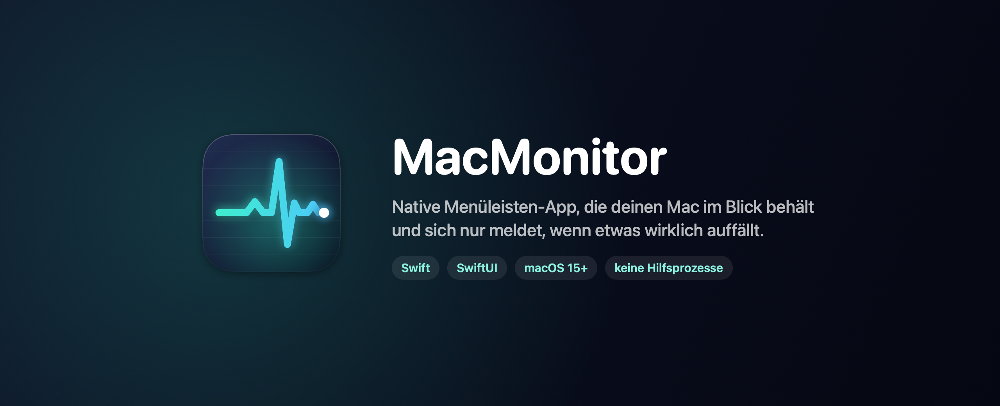
</p>

<p align="center">
  <b>MacMonitor</b> ist eine native Menüleisten-App für macOS. Sie beobachtet deinen Mac, sagt in klaren Worten, was nicht stimmt, und bietet den Knopf an, der es behebt.
</p>

<p align="center">
  <a href="https://github.com/fbrogno/mac-monitor/releases/latest"></a>
  <a href="https://github.com/fbrogno/mac-monitor/releases"></a>
  
  
  <a href="LICENSE"></a>
  <a href="https://github.com/fbrogno/mac-monitor/actions/workflows/ci.yml"></a>
  <a href="https://github.com/fbrogno/mac-monitor"></a>
</p>

<p align="center">
  <a href="https://github.com/fbrogno/mac-monitor/releases/latest"></a>
</p>

<p align="center">
  <a href="#funktionen">Funktionen</a> ·
  <a href="#installation">Installation</a> ·
  <a href="#kurzbefehle-und-automatisierung">Kurzbefehle</a> ·
  <a href="#widgets">Widgets</a> ·
  <a href="#häufige-fragen">FAQ</a>
</p>

<p align="center">
  <picture>
    <source media="(prefers-color-scheme: dark)" srcset="docs/images/popover-dark.png">
    <source media="(prefers-color-scheme: light)" srcset="docs/images/popover-light.png">
    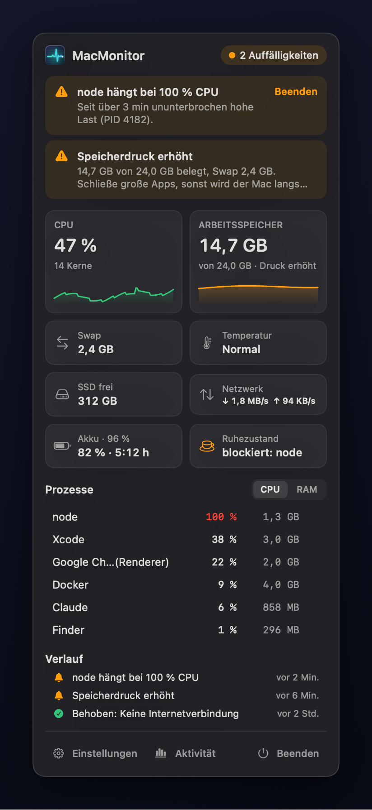
  </picture>
</p>

<details>
<summary><b>Inhalt</b></summary>

- [Warum MacMonitor](#warum-macmonitor)
- [Funktionen](#funktionen)
- [Nachschlagen](#nachschlagen): [Regeln](#alle-17-eingebauten-regeln) · [Messwerte](#alles-was-sie-misst) · [Hauptfenster](#das-hauptfenster) · [eigene Regeln](#eigene-regeln-und-aktionen) · [Einstellungen](#einstellungen-bereich-für-bereich)
- [So funktioniert es](#so-funktioniert-es)
- [Widgets](#widgets)
- [Kurzbefehle und Automatisierung](#kurzbefehle-und-automatisierung)
- [Installation](#installation) · [Deinstallation](#deinstallation)
- [Stromverbrauch](#stromverbrauch)
- [Datenschutz](#datenschutz)
- [Grenzen](#grenzen)
- [Häufige Fragen](#häufige-fragen)
- [Aus dem Quelltext bauen](#aus-dem-quelltext-bauen) · [Mitmachen](#mitmachen) · [Sicherheit](#sicherheit)
- [Star-Verlauf](#star-verlauf) · [Lizenz](#lizenz)

</details>

## Warum MacMonitor

Die meisten Monitore zeigen Zahlen und überlassen dir das Deuten. MacMonitor bleibt still, solange dein Mac in Ordnung ist, und misst mit fast keiner eigenen Last. Hält etwas länger an, ein hängender Prozess, knapper Speicher, eine heiße CPU, eine volle Platte, kommt eine echte macOS-Mitteilung. Sie sagt in klaren Worten, was los ist, nennt die wahrscheinliche Ursache und gibt dir die Knöpfe dafür: App neu starten, beenden, stummschalten, die SSD aufräumen.

Kurze Spitzen zählen nicht. Eine Regel meldet sich erst, wenn der Zustand ohne Unterbrechung anhält. Danach ist Ruhe, bis es schlimmer wird oder eine Erinnerung fällig ist.

<p align="right"><a href="#top">↑ nach oben</a></p>

## Funktionen

<table>
  <tr>
    <td width="33%" valign="top">
      <picture>
        <source media="(prefers-color-scheme: dark)" srcset="docs/images/popover-dark.png">
        <source media="(prefers-color-scheme: light)" srcset="docs/images/popover-light.png">
        
      </picture>
      <br><b>Menüleisten-Fenster</b><br>
      Alle Live-Werte auf einer Seite: CPU, Speicher, Swap, GPU, Temperatur, Leistung, Lüfter, SSD, Netzwerk, Akku. Dazu Prozesse oder Apps nach CPU oder RAM und die letzten Meldungen.
    </td>
    <td width="33%" valign="top">
      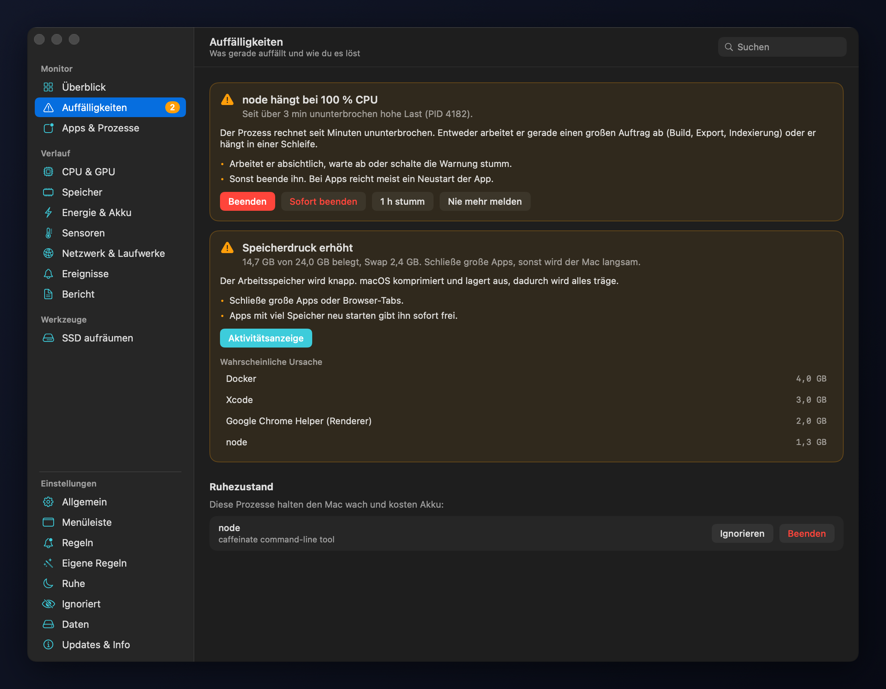
      <br><b>Auffälligkeiten mit Lösungen</b><br>
      Jede Meldung mit Erklärung, konkreten Schritten und den Knöpfen, die sie ausführen. Bei Speicher- oder CPU-Problemen stehen die wahrscheinlichen Verursacher gleich dabei.
    </td>
    <td width="33%" valign="top">
      <picture>
        <source media="(prefers-color-scheme: dark)" srcset="docs/images/window-overview.png">
        <source media="(prefers-color-scheme: light)" srcset="docs/images/window-overview-light.png">
        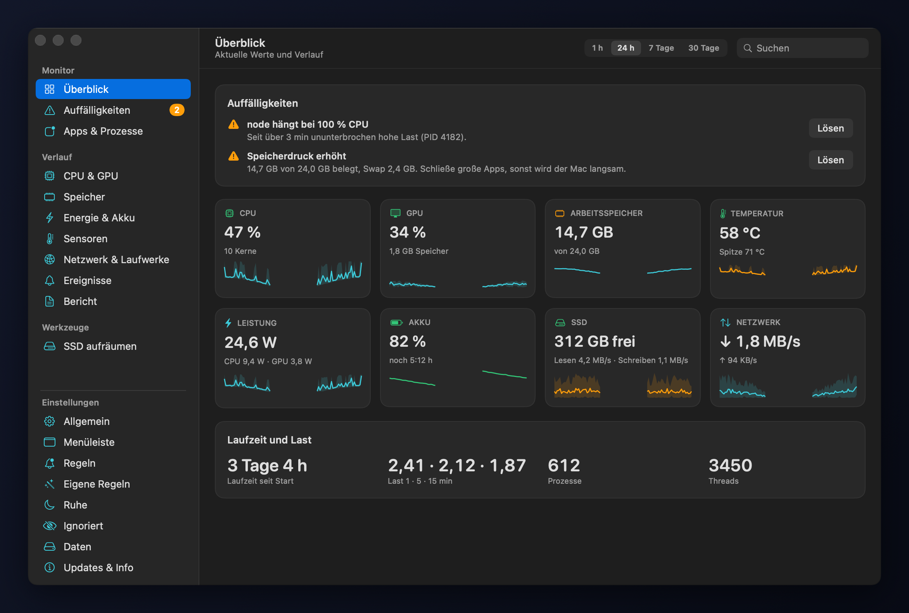
      </picture>
      <br><b>Ein Fenster mit Verlauf</b><br>
      Seitenleiste mit allen Bereichen: Live-Werte und Diagramme von 1 Stunde bis 30 Tage, Tages- oder Wochenbericht, Export als CSV und JSON.
    </td>
  </tr>
  <tr>
    <td width="33%" valign="top">
      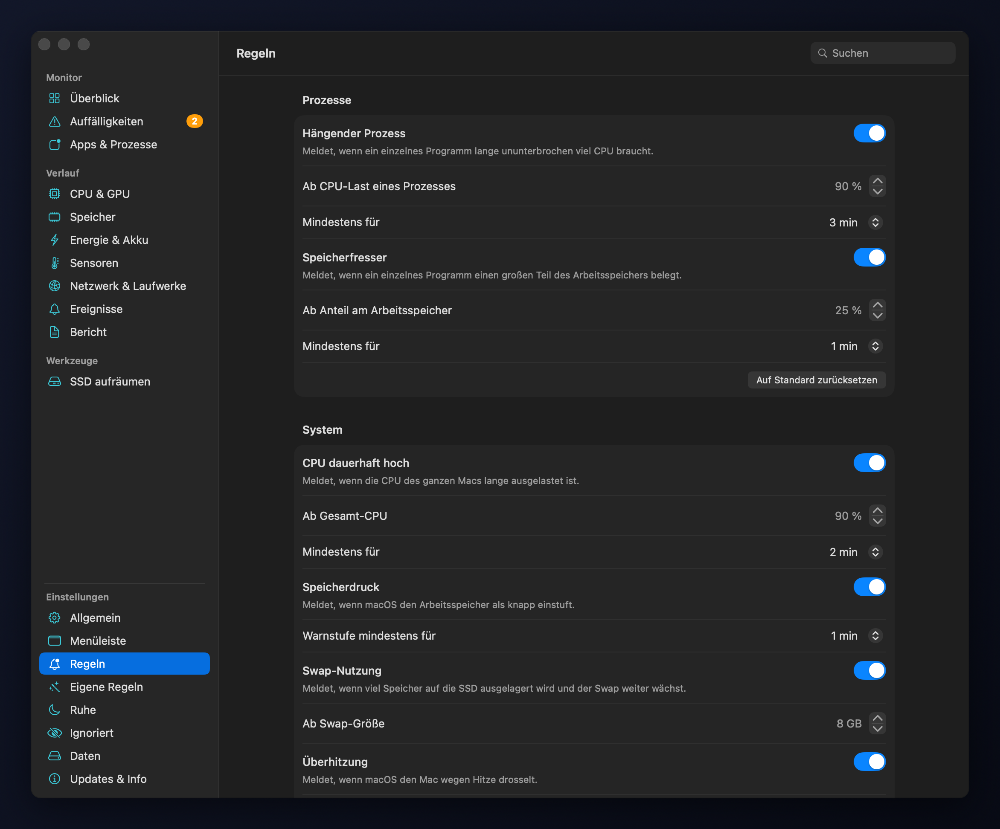
      <br><b>17 eingebaute Regeln</b><br>
      Schwellen und Dauern änderst du selbst, je Gruppe mit „Auf Standard zurücksetzen“. Prozesse lassen sich dauerhaft ignorieren oder für eine Stunde stummschalten.
    </td>
    <td width="33%" valign="top">
      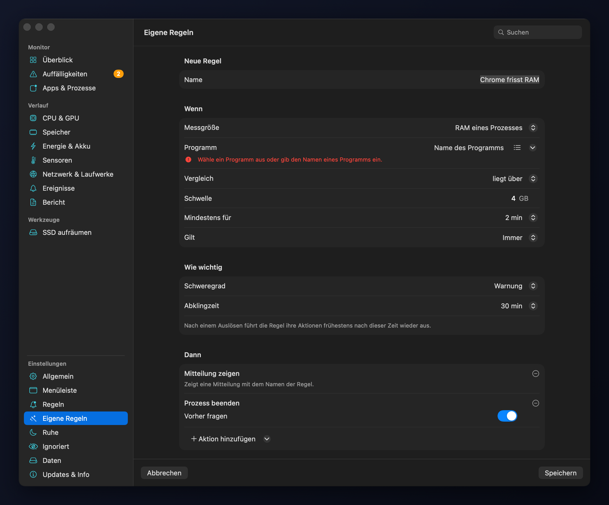
      <br><b>Eigene Regeln mit Aktionen</b><br>
      Messgröße, Grenze und Dauer wählen. Dann Mitteilung zeigen, Kurzbefehl ausführen, URL öffnen, ein Programm beenden oder drosseln.
    </td>
    <td width="33%" valign="top">
      <picture>
        <source media="(prefers-color-scheme: dark)" srcset="docs/images/widget-status-medium-alert.png">
        <source media="(prefers-color-scheme: light)" srcset="docs/images/widget-status-medium-light.png">
        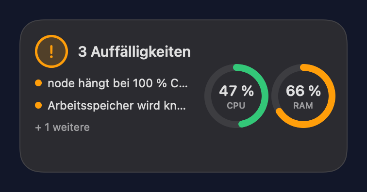
      </picture>
      <br><b>Fünf Widgets</b><br>
      Status, Auslastung, Akku, Speicherplatz und größte Verbraucher für den Schreibtisch und die Mitteilungszentrale.
    </td>
  </tr>
  <tr>
    <td width="33%" valign="top">
      
      <br><b>Kurzbefehle, Spotlight, Siri</b><br>
      Sieben Aktionen: Status, größte Verbraucher und Auffälligkeiten abrufen, Hauptfenster öffnen, stummschalten und wieder aufheben.
    </td>
    <td width="33%" valign="top">
      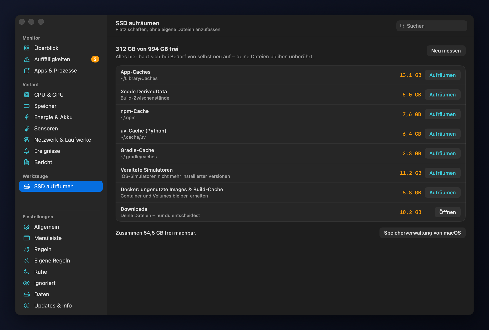
      <br><b>SSD aufräumen</b><br>
      Misst Caches, die sich von selbst neu aufbauen, und leert sie nach Rückfrage. Downloads werden nur geöffnet, nie gelöscht.
    </td>
    <td width="33%" valign="top">
      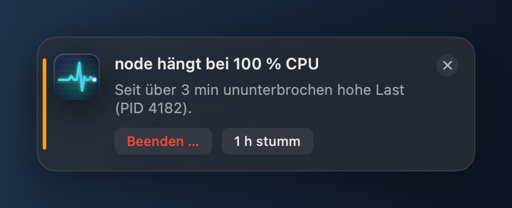
      <br><b>Hinweisfenster am aktiven Bildschirm</b><br>
      macOS zeigt Banner nur auf dem Hauptbildschirm. MacMonitor blendet zusätzlich ein Fenster auf dem Bildschirm ein, auf dem dein Mauszeiger ist.
    </td>
  </tr>
</table>

<p align="right"><a href="#top">↑ nach oben</a></p>

## Nachschlagen

Die langen Teile sind eingeklappt. Öffne, was du brauchst.

### Alle 17 eingebauten Regeln

<details>
<summary><b>Regeln mit ihren Standardwerten</b></summary>

&nbsp;

Jede Schwelle und jede Dauer lässt sich unter **Einstellungen → Regeln** ändern. Die Regeln sind so gruppiert wie dort. 16 sind standardmäßig an, „GPU dauerhaft hoch“ ist aus.

| Gruppe | Regel | Meldet, wenn (Standard) | Hinweis |
|---|---|---|---|
| Prozesse | Hängender Prozess | ein Prozess ≥ 90 % CPU über 3 min | „100 %“ ist ein voll ausgelasteter Kern, wie in der Aktivitätsanzeige |
| Prozesse | Speicherfresser | ein Prozess belegt ≥ 25 % des RAM über 1 min | |
| System | CPU dauerhaft hoch | Gesamt-CPU ≥ 90 % über 2 min | nennt die größten Verbraucher |
| System | Speicherdruck | macOS meldet „Warnung“ über 1 min, „kritisch“ sofort | kritische Meldungen kommen auch in Ruhezeiten durch |
| System | Swap-Nutzung | Swap ≥ 8 GB, solange er um ≥ 1 GB in 10 min wächst oder der Speicher knapp ist | ein hoher, aber schrumpfender Swap ist ein Überbleibsel und bleibt still |
| System | Überhitzung | thermischer Zustand „ernst“ oder „kritisch“, sofort | macOS drosselt schon |
| System | CPU-Temperatur hoch | heißester CPU-Sensor ≥ 95 °C über 2 min | tritt zurück, solange die Überhitzungs-Regel meldet |
| System | Lüfter am Anschlag | ein Lüfter ≥ 90 % seiner Höchstdrehzahl über 5 min | nur bei Macs mit Lüfter |
| System | GPU dauerhaft hoch | GPU ≥ 90 % über 5 min | **standardmäßig aus** |
| System | Internet weg | 30 s offline | Eintrag „Behoben“, wenn die Verbindung zurück ist |
| Energie & Akku | Akku-Gesundheit | Kapazität < 80 % des Neuzustands oder macOS meldet „Service empfohlen“ | höchstens einmal pro Woche, Stufe „Hinweis“ |
| Energie & Akku | Akku entlädt trotz Netzteil | am Netzteil, lädt nicht, Akku verliert ≥ 1 W über 10 min | Netzteil vermutlich zu schwach |
| Energie & Akku | Energiefresser im Akkubetrieb | eine App zieht im Schnitt von 5 min ≥ 8 W aus dem Akku | je App, Hilfsprozesse eingerechnet |
| Energie & Akku | Ruhezustand blockiert | ein Prozess hält den Mac im Akkubetrieb > 30 min wach | mit dem Programm, das ihn gestartet hat |
| Speicherplatz | Festplatte voll | < 10 % oder < 15 GB frei auf dem Startvolume | „kritisch“ unter 5 GB |
| Speicherplatz | Volume voll | ein weiteres Volume ab 1 GB (z. B. externe Platte) unter denselben Grenzen | das Startvolume gehört zu „Festplatte voll“ |
| Speicherplatz | SSD-Verschleiß | Abnutzung ≥ 80 % oder Reserve < 20 % | höchstens einmal pro Woche; „Warnung“ ab 90 % Abnutzung oder Reserve < 10 %, sonst „Hinweis“ |

Drei Verhaltensweisen gelten für alle Regeln: Eine Regel meldet erst nach ihrer Dauer, sie kommt als Erinnerung alle 30 min wieder (15 min, 30 min, 1 h oder nie unter **Einstellungen → Allgemein**), und ein Wert muss deutlich unter die Grenze fallen (auf 85 %), bevor die Meldung als behoben gilt. Ein Wert, den der Mac nicht meldet, löst nie etwas aus.

</details>

### Alles, was sie misst

<details>
<summary><b>Alle Messwerte nach Gruppe</b></summary>

&nbsp;

Ein Messwert, den dein Mac nicht meldet, wird ausgeblendet oder als „nicht verfügbar“ gekennzeichnet. Er erscheint nie als 0.

| Gruppe | Was |
|---|---|
| CPU | Gesamtlast; Last je Kern, auf Apple Silicon getrennt nach Effizienz- und Performance-Kernen; Systemlast (1, 5, 15 min) |
| Prozesse | CPU, RAM-Belegung, Threads und Plattenzugriffe je Prozess; Energie je Prozess auf Apple Silicon; Hilfsprozesse unter ihrer App zusammengefasst |
| Speicher | belegter und eingebauter RAM, Speicherdruck, Swap |
| GPU | Auslastung, genutzter und reservierter GPU-Speicher |
| Temperatur und Lüfter | thermischer Zustand (normal, leicht, ernst, kritisch); CPU-Temperatur (Durchschnitt und Spitze); Akkutemperatur; alle Sensoren als Liste; Lüfterdrehzahl mit Minimum und Maximum |
| Leistung | Gesamtleistung des Systems, Aufnahme am Netzteil; CPU-, GPU-, Neural-Engine- und RAM-Leistung auf Apple Silicon |
| Akku | Ladestand, Ladezustand, Restzeit bzw. Zeit bis voll; Ladezyklen; Kapazität in mAh gegenüber dem Neuzustand; Zustand; Temperatur; Lade- oder Entladeleistung; Leistung des Netzteils |
| Speicherplatz | freier und gesamter Platz des Startvolumes und weiterer Volumes; Lese- und Schreibrate; SSD-Zustand aus der Selbstdiagnose des Laufwerks (Abnutzung, Reserve, Temperatur, Betriebsstunden, geschriebene Datenmenge) |
| Netzwerk | online oder offline; Download- und Upload-Rate gesamt und je Schnittstelle; aktive Schnittstelle (WLAN, Ethernet, sonstige) und lokale IP-Adresse |
| Ruhezustand | Programme, die den Mac wach halten, mit Grund und dem Programm, das sie gestartet hat |
| System | Laufzeit seit Start, Anzahl der Prozesse und Threads |

Was je nach Mac abweicht, steht unter [Grenzen](#grenzen).

</details>

### Das Hauptfenster

<details>
<summary><b>Seitenleiste, Bereiche und Bilder</b></summary>

&nbsp;

Ein Fenster enthält alles: Live-Werte, Verlauf, Werkzeuge und Einstellungen. Solange es offen ist, zeigt MacMonitor auch ein Dock-Symbol. Öffnen über das Menüleisten-Fenster, über ein [Tastenkürzel](#einstellungen-bereich-für-bereich) oder mit `open macmonitor://open/<bereich>`. <kbd>⌘</kbd><kbd>,</kbd> springt zu den Einstellungen, <kbd>⌘1</kbd> bis <kbd>⌘9</kbd> (und <kbd>⌘0</kbd>) zu den ersten zehn Bereichen der Seitenleiste. Das Suchfeld in der Seitenleiste findet Bereiche und Einstellungen über Namen und Stichwörter.

Bereiche mit Diagrammen teilen sich einen Zeitraum-Schalter: 1 Stunde, 24 Stunden, 7 Tage, 30 Tage. Die Diagramme zeigen den Durchschnitt mit einem Band von Minimum bis Maximum und beim Darüberfahren die genauen Werte. Der Bericht hat einen eigenen Zeitraum, Tag oder Woche.

| Gruppe | Bereich | Zeigt |
|---|---|---|
| Monitor | Überblick | alle wichtigen Werte als Kacheln mit kleinem Diagramm, Laufzeit, Last und Prozessanzahl |
| Monitor | Auffälligkeiten | aktuelle Meldungen mit Erklärung, Schritten und „Lösen“-Knöpfen |
| Monitor | Apps & Prozesse | alle Apps jetzt mit CPU, RAM, Energie, Threads und Plattenzugriffen, Hilfsprozesse aufklappbar; die größten Verbraucher im gewählten Zeitraum |
| Verlauf | CPU & GPU | CPU im Verlauf mit Effizienz- und Performance-Kernen, Balken je Kern, GPU-Last und GPU-Speicher, Systemlast |
| Verlauf | Speicher | Belegung, Druck und Swap im Verlauf |
| Verlauf | Energie & Akku | Systemleistung aufgeteilt in CPU, GPU, Neural Engine und Arbeitsspeicher, Ladestand, Akkuzustand |
| Verlauf | Sensoren | Temperaturen, Lüfter und SSD-Zustand |
| Verlauf | Netzwerk & Laufwerke | Durchsatz gesamt und je Schnittstelle, Verbindung, Laufwerke, Lese- und Schreibrate |
| Verlauf | Ereignisse | alle Meldungen im Zeitraum, zu Vorfällen mit Dauer zusammengefasst, und das Rohprotokoll |
| Verlauf | Bericht | Zusammenfassung für Tag oder Woche mit Änderung zur Vorperiode, Vorfälle je Regel, größte Programme, Export und Löschen |
| Werkzeuge | SSD aufräumen | Caches und Reste, die sich von selbst neu aufbauen, gemessen und nach Rückfrage geleert |
| Einstellungen | Allgemein, Menüleiste, Regeln, Eigene Regeln, Ruhe, Ignoriert, Daten, Updates & Info | siehe [Einstellungen](#einstellungen-bereich-für-bereich) |

<table>
  <tr>
    <td width="50%"><br><sub>Überblick</sub></td>
    <td width="50%"><br><sub>Auffälligkeiten</sub></td>
  </tr>
  <tr>
    <td width="50%">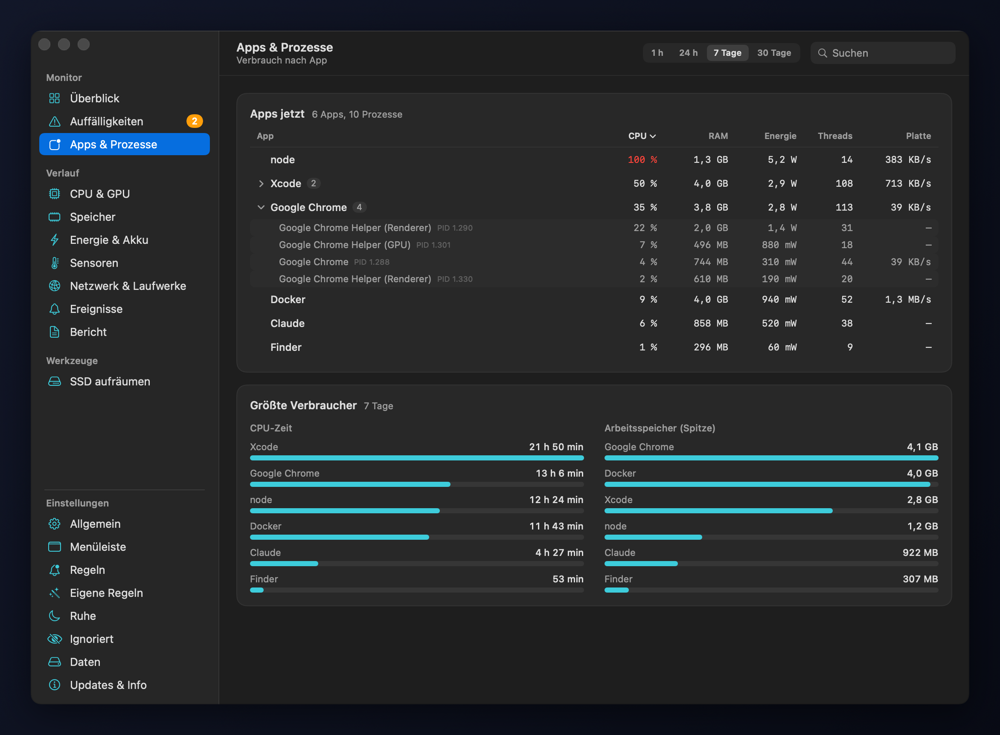<br><sub>Apps &amp; Prozesse</sub></td>
    <td width="50%">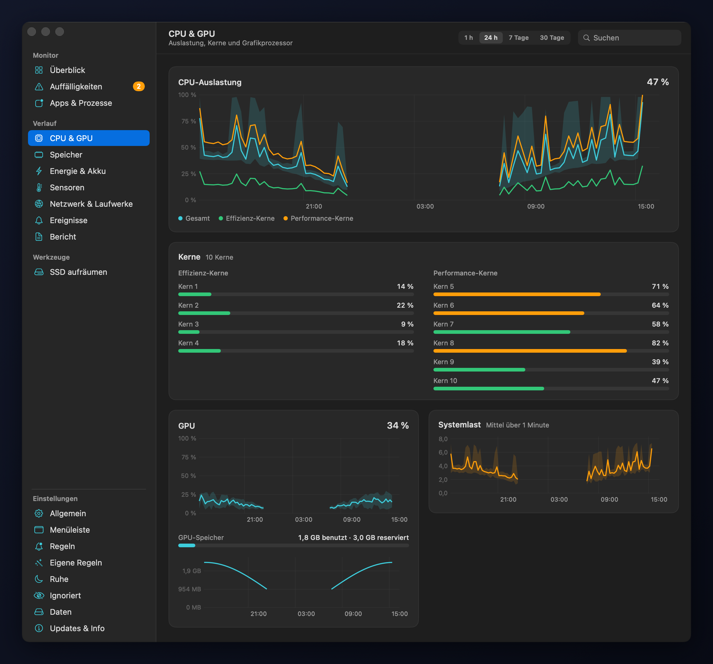<br><sub>CPU &amp; GPU</sub></td>
  </tr>
  <tr>
    <td width="50%">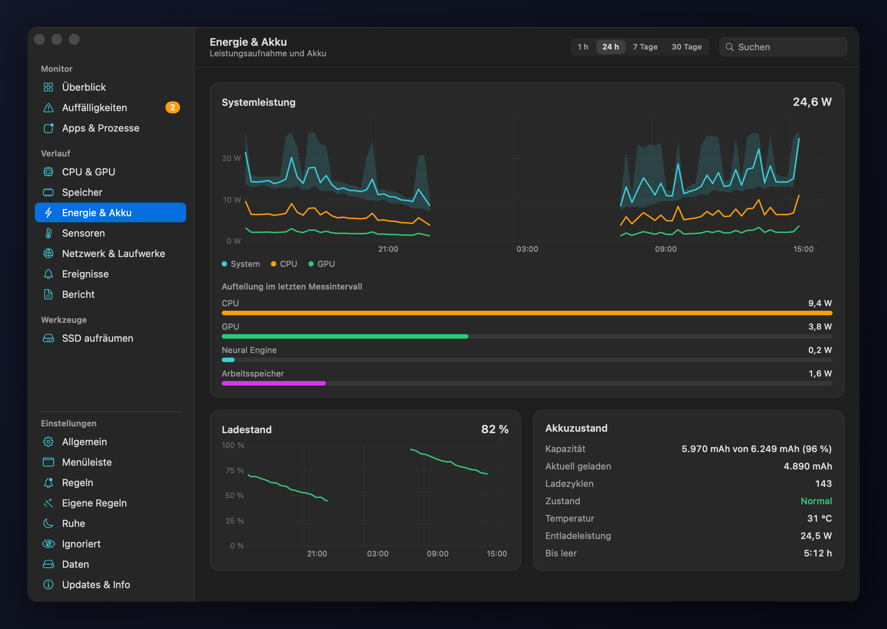<br><sub>Energie &amp; Akku</sub></td>
    <td width="50%">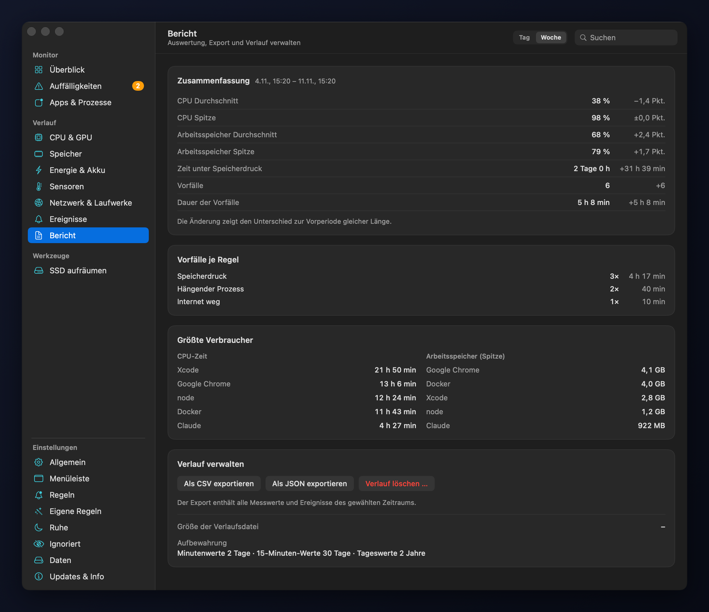<br><sub>Bericht</sub></td>
  </tr>
  <tr>
    <td colspan="2"><br><sub>SSD aufräumen</sub></td>
  </tr>
</table>

Helle und dunkle Darstellung folgen dem System.

**Verlauf.** Er liegt in einer SQLite-Datei auf deinem Mac. Minutenwerte werden 2 Tage aufbewahrt, 15-Minuten-Werte 30 Tage, Tageswerte 2 Jahre. Meldungen bleiben 90 Tage. Der Bericht exportiert einen gewählten Zeitraum als CSV oder JSON und kann den ganzen Verlauf löschen.

</details>

### Eigene Regeln und Aktionen

<details>
<summary><b>Wie eigene Regeln funktionieren und was dich schützt</b></summary>

&nbsp;

Unter **Einstellungen → Eigene Regeln** legst du fest, worauf MacMonitor achten soll.

- **Messgröße** (13): Gesamt-CPU, belegter Arbeitsspeicher, Swap, GPU-Auslastung, CPU-Temperatur, Lüfterdrehzahl, Systemleistung, Akkustand, freier Speicherplatz, Netzwerk-Download, Netzwerk-Upload, CPU eines Programms, RAM eines Programms.
- **Bedingung:** über oder unter einer Schwelle, für eine Mindestdauer (Standard 1 min), auf Wunsch nur im Akkubetrieb oder nur am Netzteil.
- **Wichtigkeit:** Hinweis, Warnung oder kritisch, dazu eine Abklingzeit (Standard 30 min), bevor die Aktionen wieder laufen dürfen.
- **Aktionen:** Mitteilung zeigen, Kurzbefehl aus deiner Liste ausführen, URL öffnen, ein Programm beenden (auf Wunsch erst nach Rückfrage), ein Programm drosseln. Beenden und Drosseln gibt es nur für die beiden Messgrößen eines Programms.

Fünf Vorlagen helfen beim Start, zum Beispiel „Chrome frisst RAM“ (nach Rückfrage beenden, über 4 GB für 2 min) oder „Akku unter 20 %“. Unvollständige Regeln lassen sich nicht speichern, der Editor sagt am Feld, was fehlt. Jede ausgeführte Aktion und jeder Fehler steht im Ereignisprotokoll. Eine Regel, die sich nicht lesen lässt, wird beim Laden übersprungen, die übrigen bleiben.


**Sicherheit.**

- Aktionen laufen einmal, wenn die Regel auslöst, nicht erneut bei Erinnerungen.
- „Beenden“ schickt eine höfliche Bitte zum Beenden (SIGTERM), keinen Abschuss.
- Programme des Systems und MacMonitor selbst werden nie angefasst. Das gilt für niedrige Prozessnummern, eine Liste zentraler macOS-Dienste, Programme aus `/System/Library` und Hintergrunddienste ohne App-Paket, deren Name auf „d“ endet.
- Direkt vor dem Signal prüft MacMonitor, ob die Prozessnummer noch zum selben Programm gehört. macOS vergibt Prozessnummern neu.
- Drosseln senkt die Priorität (nice 10, Hintergrundpriorität). Das wird nicht von selbst zurückgenommen. Im Ereignisprotokoll steht, wann die Bedingung endet.
- „URL öffnen“ nimmt Web-Adressen und Adressen von Apps. Lokale Dateien und Schemata wie `file`, `ssh` oder `javascript` werden abgelehnt.

</details>

### Einstellungen, Bereich für Bereich

<details>
<summary><b>Die acht Bereiche, Ruhezeiten und Tastenkürzel</b></summary>

&nbsp;

Die Einstellungen sind die letzte Gruppe in der Seitenleiste des Hauptfensters, oder <kbd>⌘</kbd><kbd>,</kbd> von überall.

| Bereich | Inhalt |
|---|---|
| Allgemein | Beim Anmelden starten, Hinweisfenster (aus, wenn ich an einem anderen Bildschirm bin (Standard), immer), Erinnerungsabstand |
| Menüleiste | bis zu drei Werte neben dem Symbol: CPU, RAM, GPU, Temperatur, Leistung, Netz ↓, Akku. Standard: nur Symbol. Drei optionale Tastenkürzel |
| Regeln | die 17 Regeln mit Schaltern, Schwellen, Dauern, „Auf Standard zurücksetzen“ je Gruppe |
| Eigene Regeln | deine Regeln, Vorlagen, Editor |
| Ruhe | was wann stummgeschaltet wird |
| Ignoriert | Programme, die nie Prozess-Meldungen auslösen (Standard: `kernel_task`, `mds_stores`, `mdworker_shared`, `photoanalysisd`), und gerade stummgeschaltete Programme |
| Daten | Größe und Aufbewahrung des Verlaufs, Export, Löschen, Export und Import deiner Einstellungen als JSON |
| Updates & Info | automatische Update-Prüfung, jetzt prüfen, Version, Lizenz, Hinweis zum Datenschutz, Links. Das zeigte früher das Info-Fenster |

<table>
  <tr>
    <td width="50%">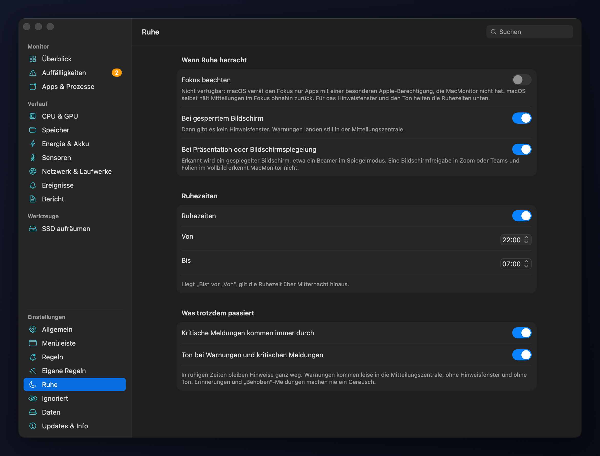</td>
    <td width="50%">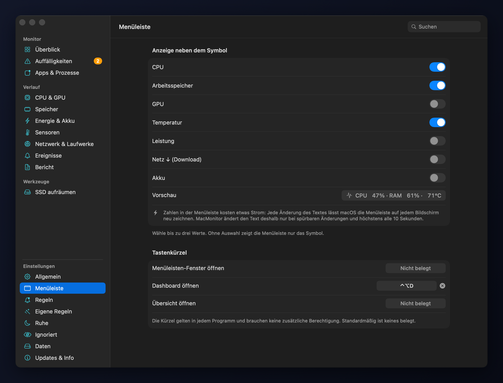</td>
  </tr>
</table>

**Ruhe.** Kein Hinweisfenster und kein Ton bei gesperrtem Bildschirm und bei gespiegeltem Bildschirm (Beamer im Spiegelmodus). Dazu optionale Ruhezeiten (standardmäßig aus, eingeschaltet 22:00 bis 07:00, auch über Mitternacht). In ruhigen Zeiten entfallen Hinweise der Stufe „Hinweis“ ganz. Warnungen landen weiter still in der Mitteilungszentrale, ohne Fenster und Ton. Kritische Meldungen kommen durch, solange du den Schalter angelassen hast (Standard). Ein Ton kommt nur bei neuen und verschärften Warnungen und kritischen Meldungen, nie bei Erinnerungen oder „Behoben“. Der Schalter „Fokus beachten“ ist ausgegraut, siehe [Grenzen](#grenzen).

**Tastenkürzel.** Menüleisten-Fenster, Hauptfenster und Auffälligkeiten öffnen. Standardmäßig ist keines belegt. Wähle eines unter Einstellungen → Menüleiste, zum Beispiel <kbd>⌃</kbd> <kbd>⌥</kbd> <kbd>D</kbd> für das Hauptfenster. Im Hauptfenster selbst gehen <kbd>⌘</kbd><kbd>,</kbd> und <kbd>⌘1</kbd> bis <kbd>⌘9</kbd> ohne Einrichtung. Sie gelten in jedem Programm und brauchen keine Bedienungshilfen-Berechtigung.

**Der Text in der Menüleiste** ändert sich nur bei spürbaren Änderungen und höchstens alle 10 Sekunden, weil jede Änderung macOS die Menüleiste auf jedem Bildschirm neu zeichnen lässt.

**Erster Start.** Ein Willkommensblatt erklärt die App und fragt nach Mitteilungen. Erneut öffnen mit `open macmonitor://welcome`.

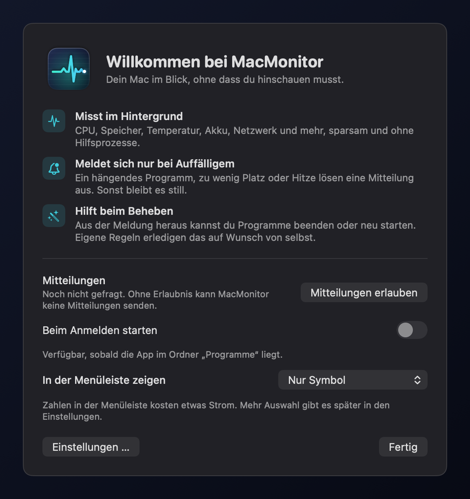

</details>

<p align="right"><a href="#top">↑ nach oben</a></p>

## So funktioniert es

<details open>
<summary><b>Aufbau</b></summary>

&nbsp;

Messer lesen den Mac und erzeugen einen Schnappschuss. Regeln machen daraus Befunde. Die Alarm-Logik entscheidet, was gemeldet wird. Verlauf, Widgets und Kurzbefehle lesen denselben Schnappschuss.

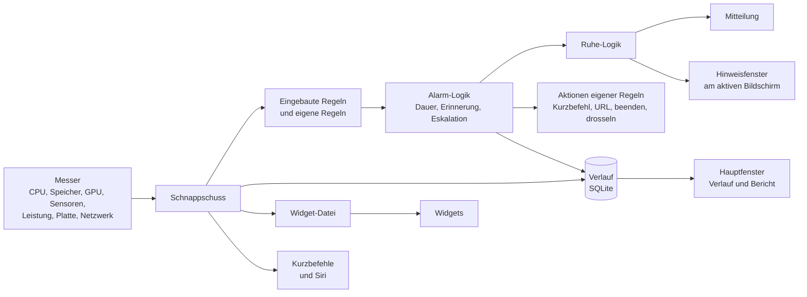

Die Regeln sind reine Funktionen: Ein Schnappschuss geht hinein, Befunde kommen heraus, ohne Uhr und ohne Nebenwirkungen. Dadurch sind sie testbar. Die Zeit führt die Alarm-Logik.

</details>

<details open>
<summary><b>Lebenslauf einer Auffälligkeit</b></summary>

&nbsp;

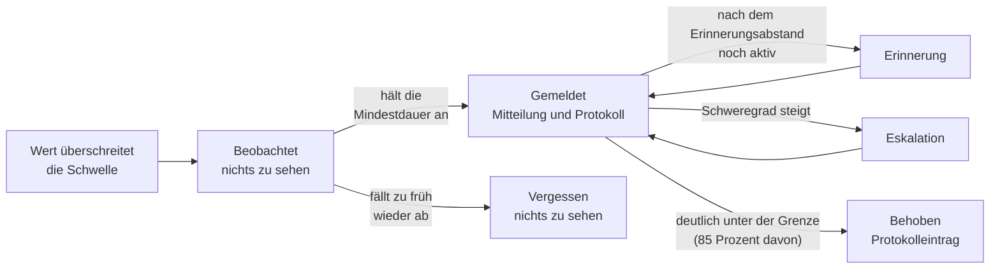

Schlaf zählt nicht: Nach dem Aufwachen beginnen alle noch beobachteten Zeitfenster neu. Bereits gemeldete Auffälligkeiten bleiben bestehen.

</details>

<p align="right"><a href="#top">↑ nach oben</a></p>

## Widgets

Fünf Widgets für den Schreibtisch und die Mitteilungszentrale. Sie zeigen Daten, die die App in einen gemeinsamen Container schreibt, funktionieren also, solange MacMonitor läuft. Sind die Daten älter als 5 Minuten, steht im Widget „MacMonitor läuft nicht“ mit dem Zeitpunkt, an dem die App zuletzt zu sehen war.

| Widget | Größen | Zeigt |
|---|---|---|
| Status | klein, mittel | Ampel, Anzahl der Auffälligkeiten, CPU und RAM |
| Auslastung | mittel | CPU, RAM und GPU mit dem Verlauf der letzten Stunde; Zusatzwerte (Temperatur und Leistung, nur eines davon oder keine) stellst du am Widget ein |
| Akku und Energie | klein, mittel | Ladestand, Restlaufzeit, Leistung, Akku-Zustand, Ladezyklen |
| Speicherplatz | klein, mittel | freier Platz auf dem Startvolume |
| Größte Verbraucher | mittel, groß | die Apps mit der höchsten Last |

Ein Klick auf ein Widget öffnet das Hauptfenster bei den Auffälligkeiten oder im passenden Bereich.

<details>
<summary><b>Widget-Galerie</b></summary>

&nbsp;

<table>
  <tr>
    <td valign="top">
      <picture>
        <source media="(prefers-color-scheme: dark)" srcset="docs/images/widget-status-medium-alert.png">
        <source media="(prefers-color-scheme: light)" srcset="docs/images/widget-status-medium-light.png">
        
      </picture><br><sub>Status, mittel</sub>
    </td>
    <td valign="top">
      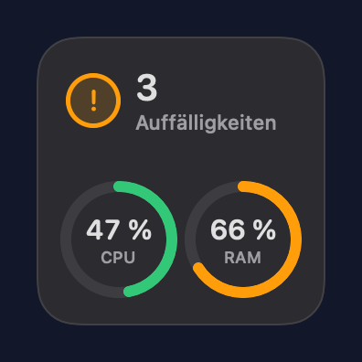<br><sub>Status, klein</sub>
    </td>
  </tr>
  <tr>
    <td valign="top">
      <picture>
        <source media="(prefers-color-scheme: dark)" srcset="docs/images/widget-load-medium.png">
        <source media="(prefers-color-scheme: light)" srcset="docs/images/widget-load-medium-light.png">
        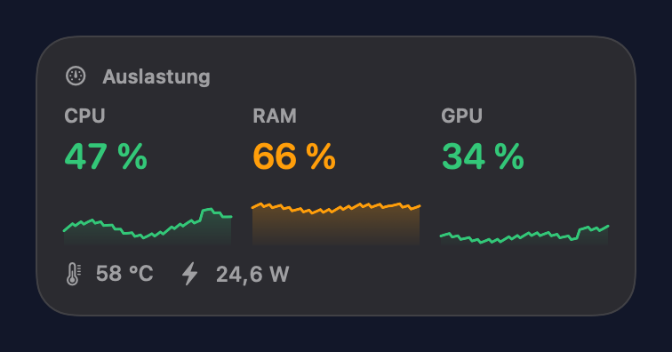
      </picture><br><sub>Auslastung, mittel</sub>
    </td>
    <td valign="top">
      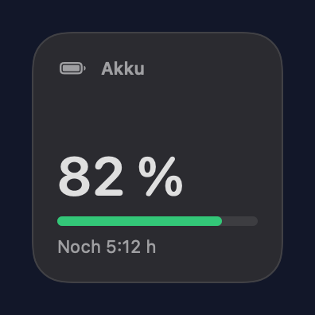<br><sub>Akku, klein</sub>
    </td>
  </tr>
  <tr>
    <td valign="top">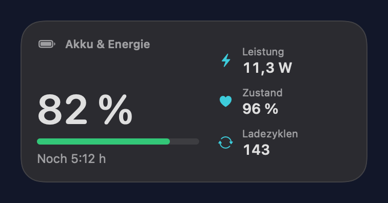<br><sub>Akku und Energie, mittel</sub></td>
    <td valign="top">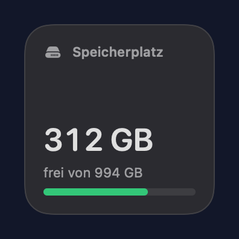<br><sub>Speicherplatz, klein</sub></td>
  </tr>
  <tr>
    <td valign="top">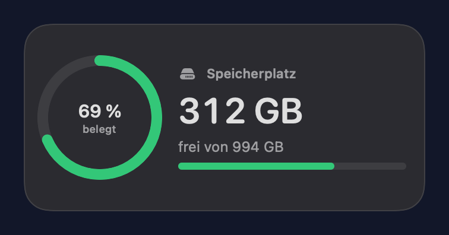<br><sub>Speicherplatz, mittel</sub></td>
    <td valign="top">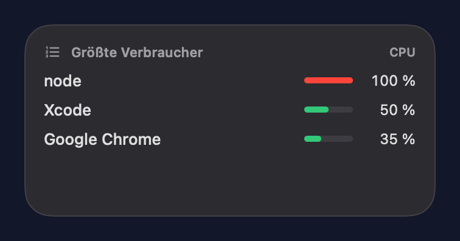<br><sub>Größte Verbraucher, mittel</sub></td>
  </tr>
  <tr>
    <td valign="top">
      <picture>
        <source media="(prefers-color-scheme: dark)" srcset="docs/images/widget-topapps-large.png">
        <source media="(prefers-color-scheme: light)" srcset="docs/images/widget-topapps-large-light.png">
        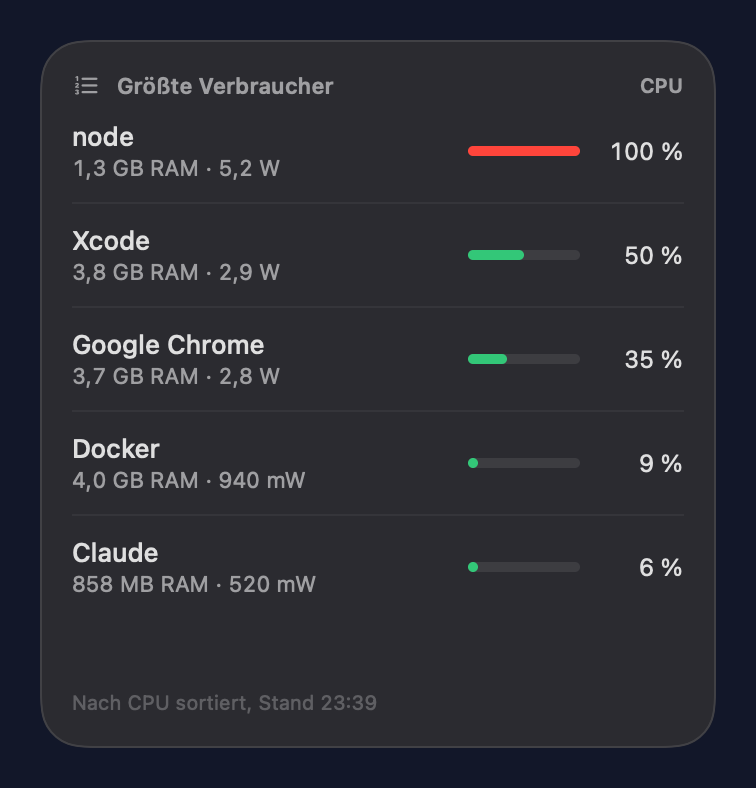
      </picture><br><sub>Größte Verbraucher, groß</sub>
    </td>
    <td valign="top">
      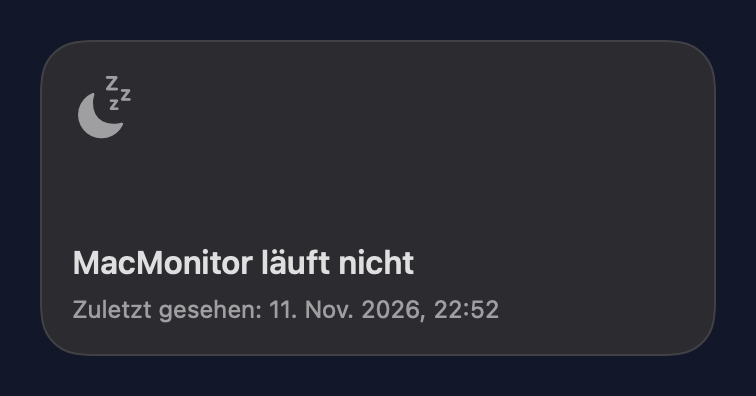<br><sub>Wenn die App nicht läuft (Daten älter als 5 min)</sub><br><br>
      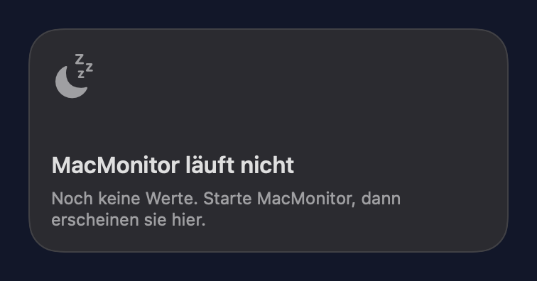<br><sub>Vor der ersten Messung</sub>
    </td>
  </tr>
</table>

</details>

<p align="right"><a href="#top">↑ nach oben</a></p>

## Kurzbefehle und Automatisierung

MacMonitor bringt sieben Aktionen in die Kurzbefehle-App. Sie funktionieren auch über Spotlight und mit Siri.

<details>
<summary><b>Die sieben Aktionen mit Beispielabläufen</b></summary>

&nbsp;

| Aktion | Was sie tut |
|---|---|
| Systemstatus abrufen | liefert CPU, RAM, GPU, Temperatur, Leistung, Akku, freien Platz, die Anzahl der Auffälligkeiten und eine Zusammenfassung in einer Zeile |
| Größte Verbraucher abrufen | liefert die Apps mit der höchsten Last, nach CPU, Arbeitsspeicher oder Energie sortiert (1 bis 20, Standard 5) |
| Auffälligkeiten abrufen | liefert die aktuellen Auffälligkeiten mit Titel, Schweregrad und Beschreibung |
| Dashboard öffnen | öffnet das Hauptfenster in einem Bereich deiner Wahl |
| Übersicht öffnen | öffnet das Hauptfenster bei den aktuellen Auffälligkeiten |
| Meldungen stummschalten | schaltet MacMonitor für eine wählbare Zeit stumm (Standard 1 Stunde) |
| Stummschaltung aufheben | beendet die Stummschaltung |

Das sind Ideen, die sich aus diesen Aktionen bauen lassen. Zusammenstellen musst du sie selbst in der Kurzbefehle-App:

- **Morgen-Check.** Systemstatus abrufen, dann Ergebnis anzeigen oder Text sprechen. Du bekommst die Zusammenfassung in einer Zeile.
- **Nur wenn etwas nicht stimmt.** Auffälligkeiten abrufen, dann „Wenn einen Wert hat“, dann dir selbst eine Nachricht mit den Titeln schicken.
- **Präsentation.** Zu einer Uhrzeit oder beim Öffnen einer App: Meldungen stummschalten für 2 Stunden.
- **Großer Auftrag fertig.** Ausführen, dann Stummschaltung aufheben.
- **Was bremst meinen Mac?** Größte Verbraucher abrufen, nach Speicher sortiert, dann Ergebnis anzeigen.

Auch umgekehrt geht es: Eine [eigene Regel](#eigene-regeln-und-aktionen) kann beim Auslösen einen beliebigen Kurzbefehl von dir ausführen.


</details>

<details>
<summary><b>URL-Befehle</b></summary>

&nbsp;

Für Skripte, Kurzbefehle und das Terminal. Die App muss installiert sein.

| Befehl | Öffnet |
|---|---|
| `open macmonitor://overview` | das Hauptfenster bei den Auffälligkeiten |
| `open macmonitor://cleanup` | SSD aufräumen |
| `open macmonitor://dashboard` | das Hauptfenster (bleibt im aktuellen Monitor- oder Verlaufs-Bereich, sonst Überblick) |
| `open macmonitor://dashboard/<bereich>` | einen Bereich aus Monitor, Verlauf oder Werkzeuge, Namen siehe unten |
| `open macmonitor://settings` | die Einstellungen (zuletzt gezeigter Bereich) |
| `open macmonitor://settings/<bereich>` | einen Einstellungsbereich, Namen siehe unten |
| `open macmonitor://open/<bereich>` | jeden Bereich des Hauptfensters; ohne Namen den aktuellen |
| `open macmonitor://welcome` | das Willkommensblatt |
| `open macmonitor://about` | Einstellungen, Updates & Info |
| `open macmonitor://test` | sendet eine Testmitteilung |

Groß- und Kleinschreibung spielt keine Rolle. Jeder Bereich hat seinen englischen und seinen deutschen Namen, mit oder ohne Umlaute:

| Bereich | Namen |
|---|---|
| Überblick | `overview`, `ueberblick`, `überblick` |
| Auffälligkeiten | `issues`, `auffaelligkeiten`, `uebersicht`, `meldungen` |
| Apps & Prozesse | `apps`, `prozesse`, `apps-prozesse` |
| CPU & GPU | `cpu` |
| Speicher | `memory`, `speicher`, `ram` |
| Energie & Akku | `energy`, `energie`, `akku` |
| Sensoren | `sensors` |
| Netzwerk & Laufwerke | `network`, `netzwerk`, `laufwerke` |
| Ereignisse | `events`, `ereignisse` |
| Bericht | `report`, `bericht` |
| SSD aufräumen | `cleanup`, `aufraeumen`, `werkzeuge`, `ssd` |
| Allgemein | `general`, `allgemein` |
| Menüleiste | `menuBar`, `menuebar`, `menueleiste`, `menüleiste` |
| Regeln | `rules`, `regeln` |
| Eigene Regeln | `customRules`, `eigene-regeln`, `eigene` |
| Ruhe | `quiet`, `ruhe` |
| Ignoriert | `ignored`, `ignoriert` |
| Daten | `data`, `daten` |
| Updates & Info | `about`, `info`, `updates`, `ueber` |

`dashboard/<bereich>` nimmt die Bereiche außerhalb der Einstellungen, `settings/<bereich>` nur Einstellungsbereiche; bei einem anderen Namen bleibt der aktuelle Bereich. `open/<bereich>` nimmt alle.

</details>

<p align="right"><a href="#top">↑ nach oben</a></p>

## Installation

1. Die aktuelle `MacMonitor-<Version>.dmg` vom [neuesten Release](https://github.com/fbrogno/mac-monitor/releases/latest) laden.
2. DMG öffnen und MacMonitor in den Ordner **Programme** ziehen.
3. Starten. macOS fragt, ob MacMonitor Mitteilungen senden darf. Erlaube es: Ohne siehst du nur das Hinweisfenster. Beim ersten Start aus „Programme“ trägt sich die App außerdem als Anmeldeobjekt ein. Das lässt sich unter Einstellungen → Allgemein abschalten.

Die App ist mit Developer ID signiert und von Apple notarisiert. Neue Versionen lädt sie selbst über [Sparkle](https://sparkle-project.org): automatisch im Hintergrund (abschaltbar) oder per „Nach Updates suchen …“ unter Einstellungen → Updates & Info. Ein gefundenes Update meldet sie ruhig mit einer Mitteilung und einem Knopf im Menüleisten-Fenster. Es öffnet sich kein Fenster ungefragt.

**Voraussetzungen:** macOS 15 oder neuer, Mac mit Apple Silicon oder Intel. Manche Messwerte hängen vom Modell ab, siehe [Grenzen](#grenzen).

### Deinstallation

1. Unter Einstellungen → Allgemein „Beim Anmelden starten“ abschalten und MacMonitor beenden.
2. MacMonitor aus „Programme“ in den Papierkorb ziehen.
3. Wer will, entfernt auch, was die App angelegt hat:

| Was | Wo |
|---|---|
| Einstellungen und eigene Regeln | `~/Library/Preferences/com.fbrogno.macmonitor.plist` (oder im Terminal: `defaults delete com.fbrogno.macmonitor`) |
| Verlauf | `~/Library/Application Support/MacMonitor/` |
| Widget-Daten | `~/Library/Group Containers/<Team-ID>.com.fbrogno.macmonitor` |

<p align="right"><a href="#top">↑ nach oben</a></p>

## Stromverbrauch

MacMonitor startet zum Messen keine Hilfsprozesse (kein `top`, `ps`, keine Skripte). Es ruft das System direkt auf: `host_statistics` für die CPU, `host_statistics64` und `sysctl` für Speicher, Swap, Speicherdruck und Netzwerk-Zähler, `proc_pid_rusage` für CPU-Zeit und Belegung je Prozess, IOKit für Akku und Power-Assertions.

- **Adaptives Intervall:** alle 2 s bei offenem Menüleisten-Fenster, sonst alle 10 s am Netzteil, 20 s im Akkubetrieb und 30 s im Stromsparmodus. Der Timer hat 25 % Toleranz, damit macOS die Weckungen mit anderer Arbeit zusammenlegen kann.
- **Ereignisse statt Abfragen:** Speicherdruck, Temperatur, Stromquelle und Aufwachen lösen sofort eine Messung aus.
- **Caches:** SSD-Platz, Volumes, SSD-Zustand und Akku-Gesundheit werden alle 5 min gelesen, Schlaf-Blockierer jede Minute. Sensoren und Leistung alle 5 bis 10 s, solange Details sichtbar sind, sonst alle 30 bis 60 s.
- **Ruhige Menüleiste:** Standard ist nur das Symbol, weil jede Textänderung macOS die Menüleiste neu zeichnen lässt (etwa 40 ms je Bildschirm).

**Messung von Version 1.0** (MacBook Pro mit M4 Pro, Fenster geschlossen): 0,12 s CPU-Zeit in 162 s, etwa 0,07 % CPU, bei konstant ~79 MB Speicher. Version 1.1 liest mehr (Sensoren, GPU, Leistung, SSD, Verlauf, Widgets) und ist noch nicht auf dieselbe Weise gemessen. Nimm die Zahl als Ausgangswert von 1.0, nicht als Zusage für 1.1.

## Datenschutz

- Alles bleibt auf deinem Mac: Einstellungen, Verlauf und Widget-Daten sind lokale Dateien.
- Die einzige Netzverbindung ist die Update-Prüfung bei GitHub (`releases/latest/download/appcast.xml`). Du kannst sie abschalten.
- Kein Konto, keine Analyse, kein Tracking. Einzelheiten und Speicherorte stehen in [PRIVACY.md](PRIVACY.md) (auf Englisch).

## Grenzen

- **Kein Netzwerk je Prozess.** MacMonitor zeigt den Durchsatz des Macs und je Schnittstelle. macOS bietet keinen öffentlichen Weg, ihn Programmen zuzuordnen.
- **Der Fokus-Modus wird nicht erkannt.** macOS verrät nur Apps mit einer besonderen Apple-Berechtigung, ob ein Fokus aktiv ist. Der Schalter ist vorhanden, aber ausgegraut. macOS hält Mitteilungen im Fokus ohnehin selbst zurück. Für Hinweisfenster und Ton helfen die Ruhezeiten.
- **Präsentationen werden nur bei gespiegeltem Bildschirm erkannt.** Bildschirmfreigabe in Zoom oder Teams und Folien im Vollbild erkennt MacMonitor nicht.
- **Prozesse von root oder anderen Benutzern sind ohne Root nicht einsehbar.** Der Kernel verweigert ihre Werte je Prozess. Sie sind in Gesamt-CPU und Speicher enthalten, fehlen aber in den Prozesslisten.
- **Sensoren hängen vom Mac-Modell ab.** Lüfter, Temperaturen, Leistungsaufteilung und SSD-Daten meldet nicht jedes Modell. Auf einem Mac ohne Lüfter oder Akku fehlen die Kacheln. Energie je Prozess und die Aufteilung der Leistung in CPU, GPU, Neural Engine und RAM gibt es nur auf Apple Silicon, die Trennung in Effizienz- und Performance-Kerne ebenfalls. Temperatur und Leistung nutzen Schnittstellen, die Apple nicht dokumentiert und ändern kann.
- **Nicht im Mac App Store.** Die Sandbox würde Kernfunktionen verbieten, siehe die [FAQ](#häufige-fragen).

<p align="right"><a href="#top">↑ nach oben</a></p>

## Häufige Fragen

<details>
<summary><b>Warum ist MacMonitor nicht im Mac App Store?</b></summary>

&nbsp;

Apps im Mac App Store müssen in der Sandbox laufen. In der Sandbox könnte MacMonitor die Prozessliste deines Benutzers nicht lesen, andere Programme nicht beenden oder drosseln, das WLAN nicht neu starten, keine Cache-Ordner in deinem Home-Verzeichnis leeren und Sensoren und Leistung nicht über die Systemschnittstellen lesen, die es nutzt. Das ist der Kern der App. Deshalb gibt es sie als signierte und notarisierte DMG über GitHub Releases, mit Updates über Sparkle. Nur die Widget-Erweiterung läuft in der Sandbox, wie WidgetKit es verlangt.

</details>

<details>
<summary><b>Warum stehen standardmäßig keine Zahlen in der Menüleiste?</b></summary>

&nbsp;

Jede Änderung des Textes lässt macOS das Symbol auf jedem Bildschirm neu zeichnen, etwa 40 ms je Bildschirm. Eine Zahl, die sich alle paar Sekunden ändert, würde mehr Energie kosten als das gesamte Messen von MacMonitor. Standard ist deshalb nur das Symbol, das nur bei einer Meldung wechselt. Wer Zahlen will, wählt bis zu drei unter Einstellungen → Menüleiste. Sie werden nur neu gezeichnet, wenn sie sich spürbar ändern, höchstens alle 10 Sekunden.

</details>

<details>
<summary><b>Warum sehe ich Prozess X nicht?</b></summary>

&nbsp;

Drei häufige Gründe. Der Prozess gehört root oder einem anderen Benutzer: Ohne Root-Rechte verweigert macOS seine Werte, er fehlt also in den Listen, seine Last steckt aber in den Gesamtwerten. Der Prozess steht auf deiner Ignorierliste (Einstellungen → Ignoriert; `kernel_task` und ein paar Indexierungs-Helfer sind standardmäßig dort). Oder du siehst die Ansicht „Prozesse“, in der Hilfsprozesse als eigene Zeilen erscheinen. Wechsle zu „Apps“, dann sind sie unter ihrer App zusammengezählt.

</details>

<details>
<summary><b>Was löscht „SSD aufräumen“ genau, und was nie?</b></summary>

&nbsp;

Es misst zuerst und löscht nichts, bevor du jeden Punkt bestätigst. Es berührt nur Orte, die Werkzeuge bei Bedarf neu aufbauen:

- **App-Caches:** der Inhalt von `~/Library/Caches`, außer `ms-playwright`, weil Playwright seine Browser nicht von selbst neu lädt. Offene Apps solltest du danach neu starten.
- **Xcode DerivedData** (`~/Library/Developer/Xcode/DerivedData`): der nächste Build dauert einmal länger.
- **npm-Cache:** `~/.npm/_cacache`.
- **uv-Cache:** `~/.cache/uv`. Andere Ordner in `~/.cache` bleiben bewusst unberührt, weil manche Indizes und Daten enthalten, die keine Wegwerf-Caches sind.
- **Gradle-Cache:** `~/.gradle/caches`.
- **Veraltete Simulatoren:** führt `xcrun simctl delete unavailable` aus und entfernt nur Simulatoren, deren iOS-Version nicht mehr installiert ist. Wird nur angezeigt, wenn die Xcode-Werkzeuge da sind.
- **Docker:** führt `docker image prune -a -f` und `docker builder prune -f` aus: ungenutzte Images und der Build-Cache. Container, gestoppte wie laufende, und Volumes bleiben erhalten. Wird nur angezeigt, wenn Docker installiert ist.

**Downloads** wird nur im Finder geöffnet, nie gelöscht, und sonst wird nichts in deinem Home-Ordner angefasst. Was in Benutzung oder geschützt ist, wird übersprungen. Gelöschte Caches landen nicht im Papierkorb.

</details>

<details>
<summary><b>Läuft es auf Intel-Macs?</b></summary>

&nbsp;

Ja, Intel-Macs werden unterstützt (vorausgesetzt wird macOS 15 oder neuer). Manche Messwerte gibt es nur auf Apple Silicon: Energie je Prozess, die Aufteilung der Leistung in CPU, GPU, Neural Engine und RAM und die Trennung in Effizienz- und Performance-Kerne (auf Intel zählen alle Kerne als eine Klasse). Die CPU-Temperatur kommt auf Intel-Macs von den klassischen Sensoren. Was ein Mac nicht meldet, wird ausgeblendet, nicht als 0 gezeigt.

</details>

<details>
<summary><b>Wie melde ich einen Fehlalarm?</b></summary>

&nbsp;

Öffne die [Vorlage „False alarm“](https://github.com/fbrogno/mac-monitor/issues/new?template=false_alarm.yml). Sag, welche Regel es war, was MacMonitor gemeldet hat, was dein Mac gerade tat, und nenne dein Mac-Modell und die macOS-Version. Das Protokoll unter Verlauf → Ereignisse hat den genauen Text und die Uhrzeit. Bis dahin kannst du Schwelle oder Dauer der Regel unter Einstellungen → Regeln erhöhen, das Programm in der Mitteilung für eine Stunde stummschalten oder auf die Ignorierliste setzen.

</details>

<details>
<summary><b>Ist es sicher, eine eigene Regel Programme beenden zu lassen?</b></summary>

&nbsp;

Sie ist vorsichtig gebaut, siehe „Sicherheit“ unter [eigene Regeln](#eigene-regeln-und-aktionen): Systemprozesse und MacMonitor selbst sind geschützt, die Prozessnummer wird direkt vor dem Signal noch einmal geprüft, und das Beenden kann vorher nachfragen. Trotzdem kann eine Regel, die ein Programm beendet, ungesicherte Arbeit darin verlieren. Fang mit „Vorher fragen“ an.

</details>

<p align="right"><a href="#top">↑ nach oben</a></p>

## Aus dem Quelltext bauen

Voraussetzung: macOS 15 oder neuer, Xcode 26 und [XcodeGen](https://github.com/yonaskolb/XcodeGen) (`brew install xcodegen`). Das Xcode-Projekt entsteht aus `project.yml` und wird nicht eingecheckt.

```bash
swift build                              # Bibliothek und Oberfläche, ohne Sparkle-Updater
swift test                               # Tests für MonitorCore
SIGN_IDENTITY=- ./scripts/build-app.sh   # build/MacMonitor.app, ad hoc signiert
```

Ein Release baut GitHub Actions, sobald ein Tag `vX.Y.Z` gepusht wird. Wie das läuft und was es braucht, steht in [docs/RELEASING.md](docs/RELEASING.md).

## Mitmachen

Fehlerberichte, Fehlalarme und kleine Pull Requests sind willkommen. [CONTRIBUTING.md](CONTRIBUTING.md) (auf Englisch) erklärt den Aufbau des Repos, die Tests, den Stil und das Commit-Format (Conventional Commits). Bei allem, was größer ist, bitte zuerst ein Issue anlegen.

## Sicherheit

Schwachstellen bitte privat über [GitHub Security Advisories](https://github.com/fbrogno/mac-monitor/security/advisories/new) melden, nicht als öffentliches Issue. Siehe [SECURITY.md](SECURITY.md) (auf Englisch).

<p align="right"><a href="#top">↑ nach oben</a></p>

## Star-Verlauf

<a href="https://www.star-history.com/?repos=fbrogno%2Fmac-monitor&type=date&legend=top-left">
  <picture>
    <source media="(prefers-color-scheme: dark)" srcset="https://api.star-history.com/chart?repos=fbrogno/mac-monitor&type=date&theme=dark&legend=top-left">
    <source media="(prefers-color-scheme: light)" srcset="https://api.star-history.com/chart?repos=fbrogno/mac-monitor&type=date&legend=top-left">
    
  </picture>
</a>

<a href="https://github.com/fbrogno/mac-monitor/graphs/contributors">
  
</a>

## Lizenz

[MIT](LICENSE), Copyright (c) 2026 Fabio Brogno.

<p align="right"><a href="#top">↑ nach oben</a></p>
