<p align="center">
  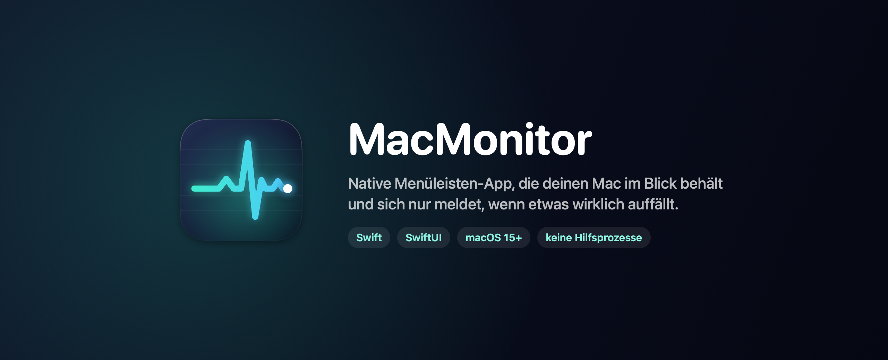
</p>

<p align="center">
  
  
  
  
</p>

**MacMonitor** ist eine native Menüleisten-App für macOS. Sie misst CPU, Speicher, Swap, Temperatur,
SSD, Netzwerk-Durchsatz, Akku und Schlaf-Blockierer direkt über die Kernel-Schnittstellen und schickt eine **echte macOS-Mitteilung**, sobald
etwas auffällt: ein Prozess, der seit Minuten hängt, ein Speicherfresser, Speicherdruck oder Überhitzung.
Solange alles normal ist, bleibt sie still und braucht kaum Strom.

<p align="center">
  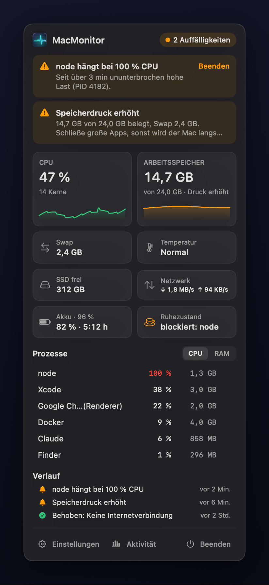
  &nbsp;
  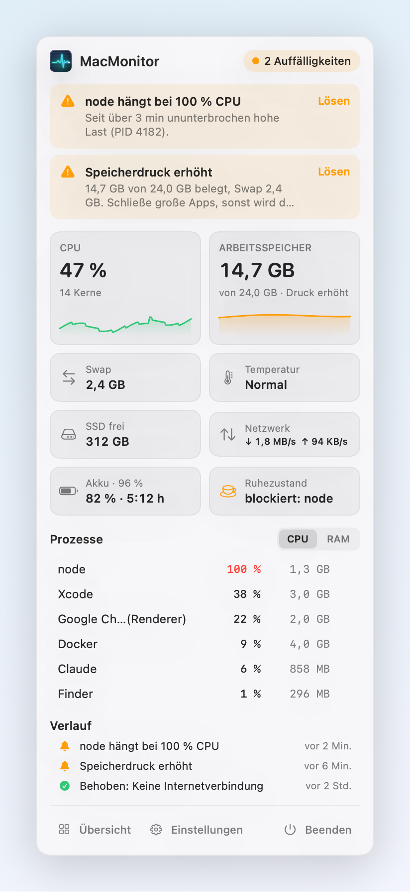
</p>

## Übersicht: verstehen und direkt lösen

Ein Klick auf eine Mitteilung, auf „Lösen“ im Popover oder im Hinweisfenster öffnet die **Übersicht**.
Jede Auffälligkeit steht dort mit Erklärung in Klartext, konkreten Schritten und Knöpfen, die sie
beheben: App neu starten, beenden, stummschalten, dauerhaft ignorieren, WLAN neu starten. Bei
Speicher- oder CPU-Problemen listet sie die wahrscheinlichen Verursacher gleich mit.

**SSD aufräumen** misst auf Knopfdruck Caches, die sich von selbst neu aufbauen (App-Caches, Xcode
DerivedData, npm, uv, Gradle, veraltete Simulatoren, ungenutzte Docker-Images), und leert sie nach
Rückfrage. Downloads werden nur geöffnet, nie gelöscht. Bewusst ausgenommen sind Daten, die keine
Wegwerf-Caches sind, etwa Playwright-Browser und Suchindizes in `~/.cache`.

<p align="center">
  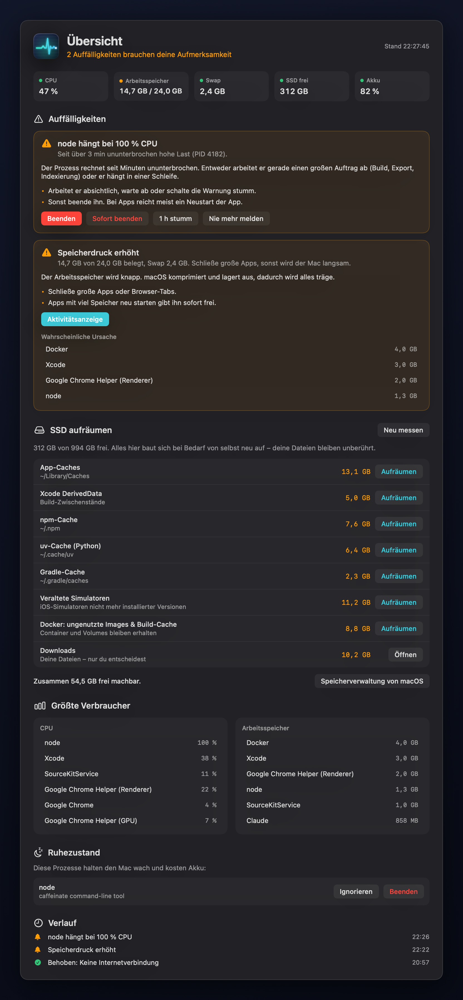
</p>

## Dashboard und Verlauf

Das **Dashboard** (Knopf im Popover oder `open macmonitor://dashboard`, einzelne Bereiche mit
`open macmonitor://dashboard/cpu|memory|energy|sensors|network|apps|events|report`) zeigt Live-Werte und
den Verlauf von 1 Stunde bis 30 Tagen: CPU, GPU, Speicher, Energie und Akku, Sensoren, Netzwerk und
Laufwerke, Apps nach Verbrauch, Ereignisse und einen Tages- oder Wochenbericht mit CSV-/JSON-Export. Werte,
die ein Mac nicht meldet, werden ausgeblendet oder als „nicht verfügbar“ gekennzeichnet, nie als 0.
Der Verlauf liegt lokal in `~/Library/Application Support/MacMonitor/history.sqlite`
(Minutenwerte 2 Tage, 15-Minuten-Werte 30 Tage, Tageswerte 2 Jahre) und lässt sich im Bericht löschen.

<p align="center">
  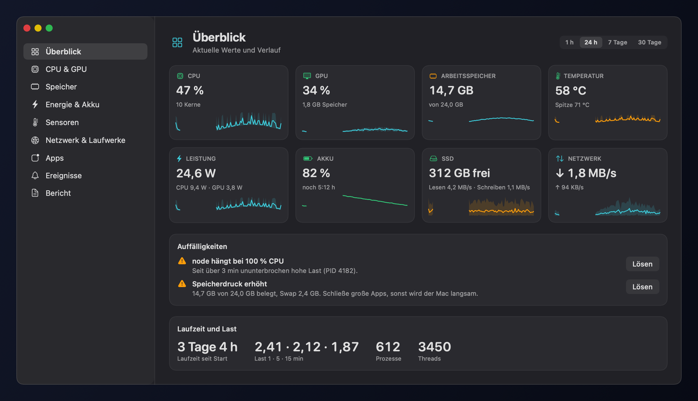
  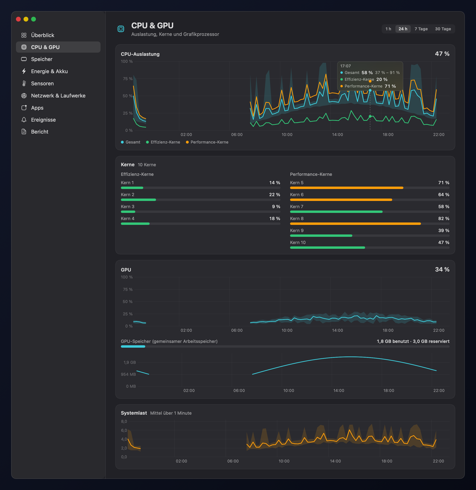
  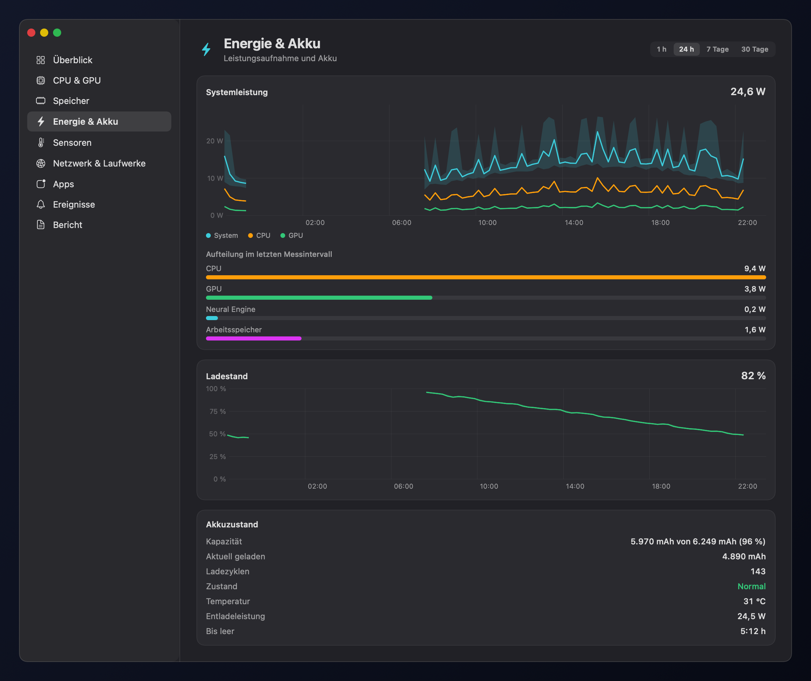
  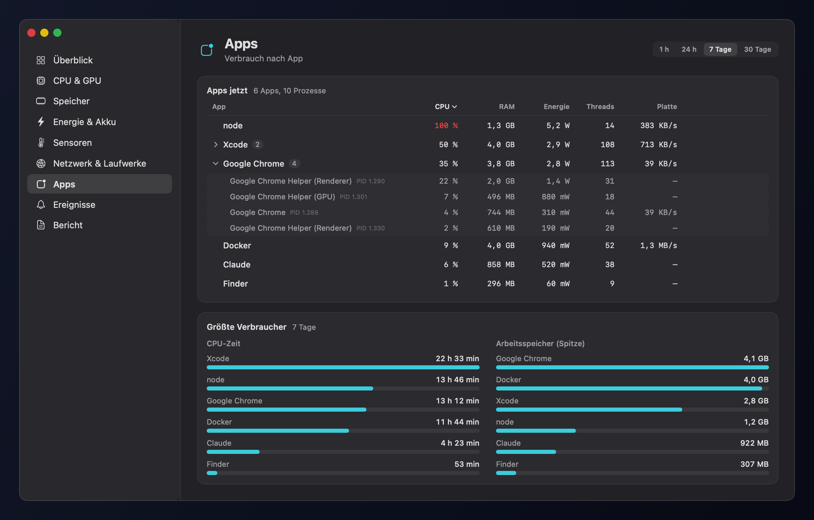
  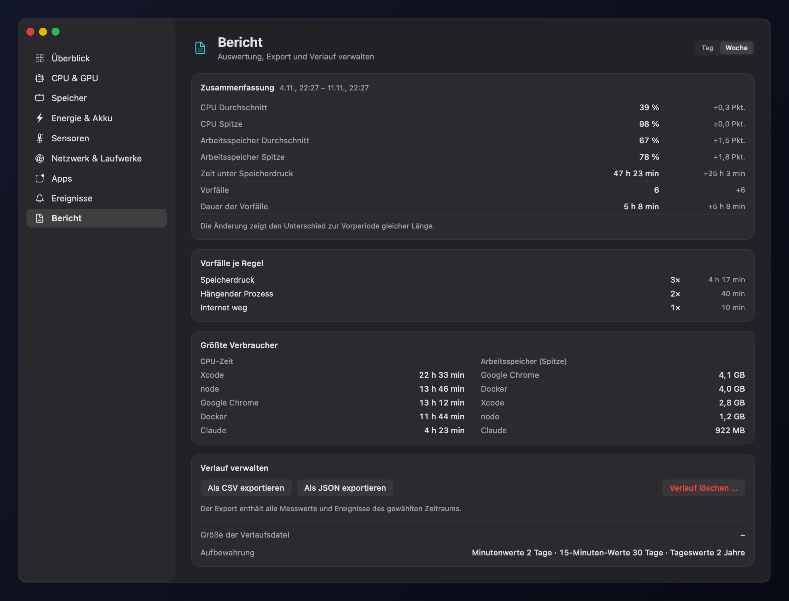
</p>

## Was die App meldet

| Regel | Standard-Auslöser | In der Mitteilung |
|---|---|---|
| Hängender Prozess | ein Prozess ≥ 90 % CPU über 3 min | Beenden …, 1 h stumm, Aktivitätsanzeige |
| Speicherfresser | ein Prozess belegt ≥ 25 % des RAM über 1 min | Beenden …, 1 h stumm |
| CPU dauerhaft hoch | Gesamt-CPU ≥ 90 % über 2 min | die größten Verbraucher |
| Speicherdruck | Warnstufe über 1 min · kritisch sofort | belegter RAM und Swap |
| Swap | ≥ 8 GB, solange er wächst (≥ 1 GB in 10 min) oder Speicher knapp ist | Apps mit viel Speicher |
| Überhitzung | thermischer Zustand „ernst“ oder „kritisch“ | größter Verbraucher |
| Festplatte voll | < 10 % oder < 15 GB frei | |
| Internet weg | 30 s offline, Meldung auch bei Wiederkehr | |
| Ruhezustand blockiert | ein Prozess verhindert im Akkubetrieb > 30 min den Schlaf | Beenden …, 1 h stumm |
| CPU-Temperatur hoch | heißester CPU-Sensor ≥ 95 °C über 2 min, noch bevor macOS drosselt | |
| Lüfter am Anschlag | ein Lüfter ≥ 90 % seiner Höchstdrehzahl über 5 min | |
| Akku-Gesundheit | Kapazität < 80 % des Neuzustands oder „Service empfohlen“, höchstens einmal pro Woche | |
| Akku entlädt trotz Netzteil | am Netzteil, aber der Akku verliert über 10 min Ladung | |
| Energiefresser im Akkubetrieb | ein Programm zieht im Schnitt der letzten 5 min ≥ 8 W aus dem Akku | Beenden …, 1 h stumm |
| SSD-Verschleiß | Abnutzung ≥ 80 % oder Reserve < 20 %, höchstens einmal pro Woche | |
| Volume voll | ein weiteres Volume (z. B. externe Platte) < 10 % oder < 15 GB frei | |
| GPU dauerhaft hoch | GPU ≥ 90 % über 5 min (standardmäßig aus) | |

Alle Schwellen, Dauern und Regeln lassen sich in den Einstellungen ändern, gruppiert nach Prozesse, System,
Energie & Akku und Speicherplatz, mit „Auf Standard zurücksetzen“ je Gruppe. Prozesse kannst du dauerhaft
ignorieren oder direkt aus der Mitteilung für eine Stunde stummschalten.

<p align="center">
  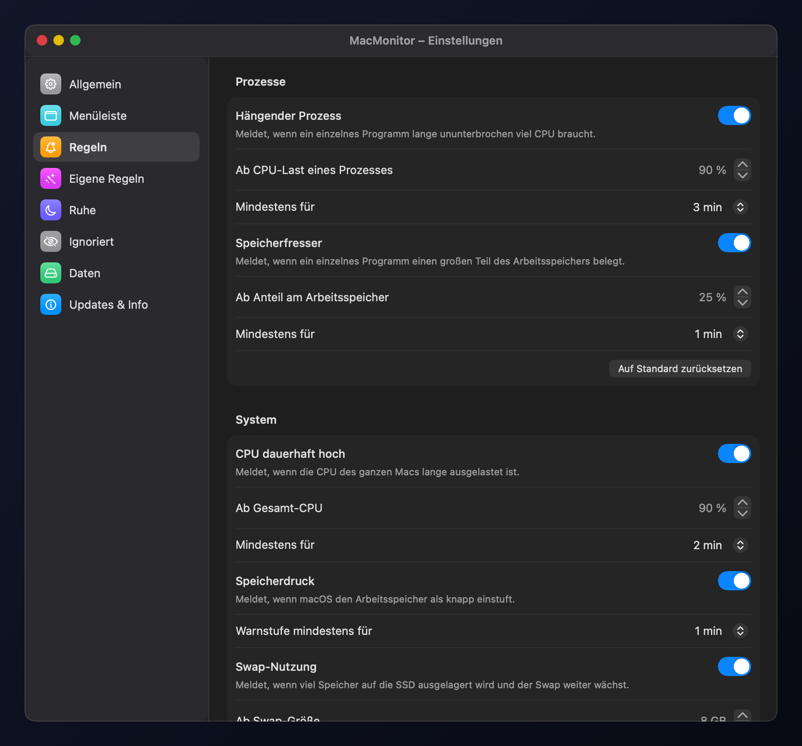
</p>

### Eigene Regeln

Unter **Einstellungen → Eigene Regeln** legst du selbst fest, worauf MacMonitor achten soll: eine Messgröße
(CPU, RAM, GPU, Temperatur, Leistung, Akku, freier Platz, Netz, oder CPU und RAM eines bestimmten
Programms), ein Vergleich mit einer Schwelle, eine Mindestdauer, auf Wunsch nur im Akkubetrieb oder nur am
Netzteil, ein Schweregrad und eine Abklingzeit. Dann führt die Regel ihre **Aktionen** aus:

- **Mitteilung zeigen**, **Kurzbefehl ausführen** (aus deiner Liste der Kurzbefehle), **URL öffnen**
  (Web-Adressen und Adressen von Apps, nie lokale Dateien),
- **Prozess beenden** (auf Wunsch erst nach Rückfrage) und **Prozess drosseln** (niedrigere Priorität). Beide
  gibt es nur für Messgrößen eines Programms. Programme des Systems und MacMonitor selbst werden nie
  angefasst; vor dem Signal prüft MacMonitor noch einmal, ob die Prozessnummer noch zum selben Programm gehört.
  Eine Drosselung wird nicht von selbst zurückgenommen, im Ereignisprotokoll steht, wann die Bedingung endet.

Vorlagen helfen beim Start. Unvollständige Regeln lassen sich nicht speichern, der Editor sagt am Feld, was
fehlt. Jede ausgeführte Aktion und jeder Fehler steht im Ereignisprotokoll. Eine Regel, die sich nicht lesen
lässt, wird beim Laden übersprungen; die übrigen bleiben erhalten.

<p align="center">
  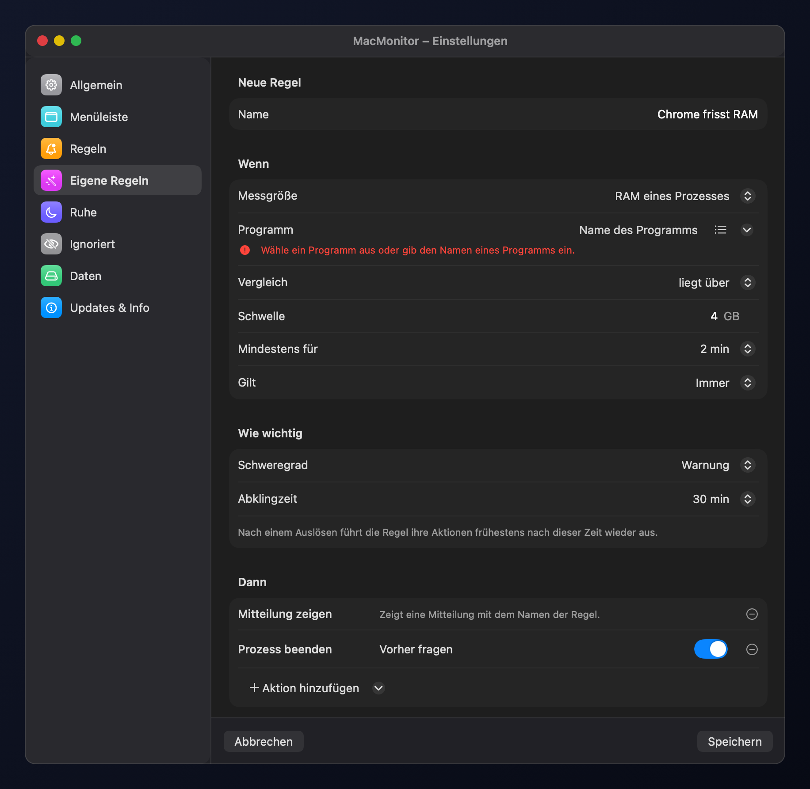
</p>

### Ruhe, Menüleiste und Kürzel

- **Ruhe:** bei gesperrtem Bildschirm und bei gespiegeltem Bildschirm (Beamer) gibt es kein Hinweisfenster und
  keinen Ton, dazu frei wählbare Ruhezeiten. Kritische Meldungen kommen auf Wunsch immer durch. Der Fokus
  von macOS lässt sich für eine App ohne besondere Apple-Berechtigung nicht auslesen, der Schalter ist
  deshalb ausgegraut. Bildschirmfreigabe in Zoom oder Teams und Folien im Vollbild erkennt MacMonitor nicht.
- **Menüleiste:** Symbol allein oder mit bis zu drei Werten (CPU, RAM, GPU, Temperatur, Leistung, Netz ↓,
  Akku). Der Text ändert sich nur bei spürbaren Änderungen und höchstens alle 10 s, weil jede Änderung
  macOS die Menüleiste neu zeichnen lässt.
- **Tastenkürzel** (standardmäßig keines belegt) für Menüleisten-Fenster, Dashboard und Übersicht, ohne
  Bedienungshilfen-Berechtigung.
- **Erster Start:** ein Willkommensfenster (erneut mit `open macmonitor://welcome`), Einstellungen mit
  `open macmonitor://settings[/regeln|eigene-regeln|ruhe|menueleiste|ignoriert|daten|info]`.

<p align="center">
  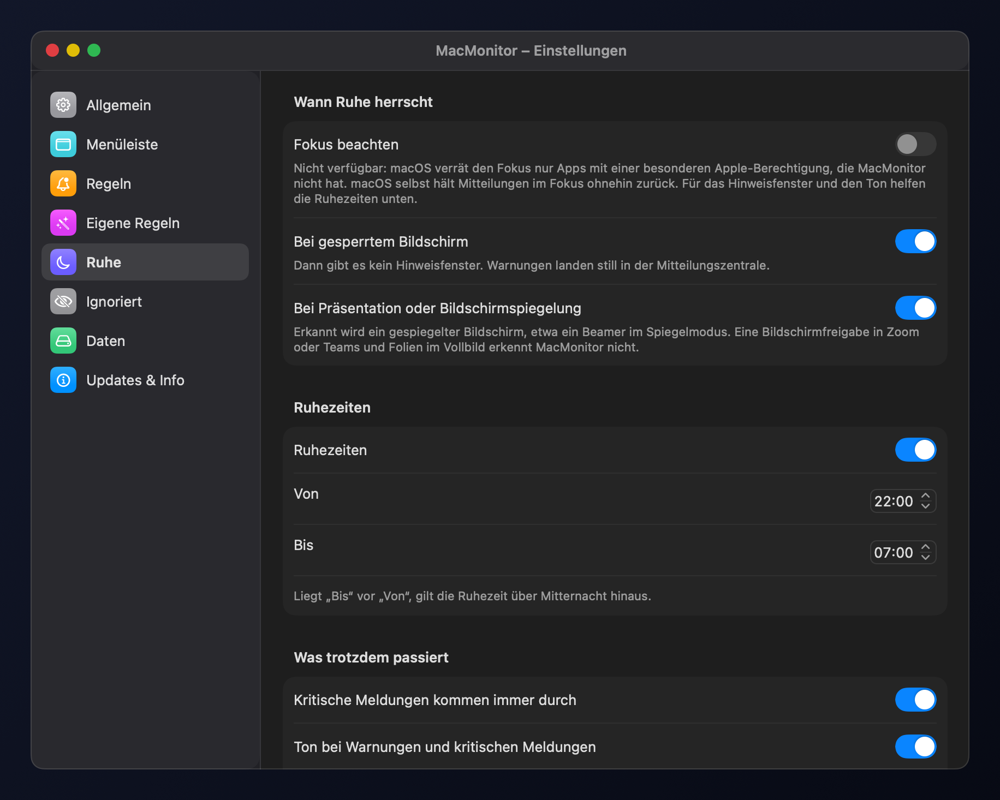
  &nbsp;
  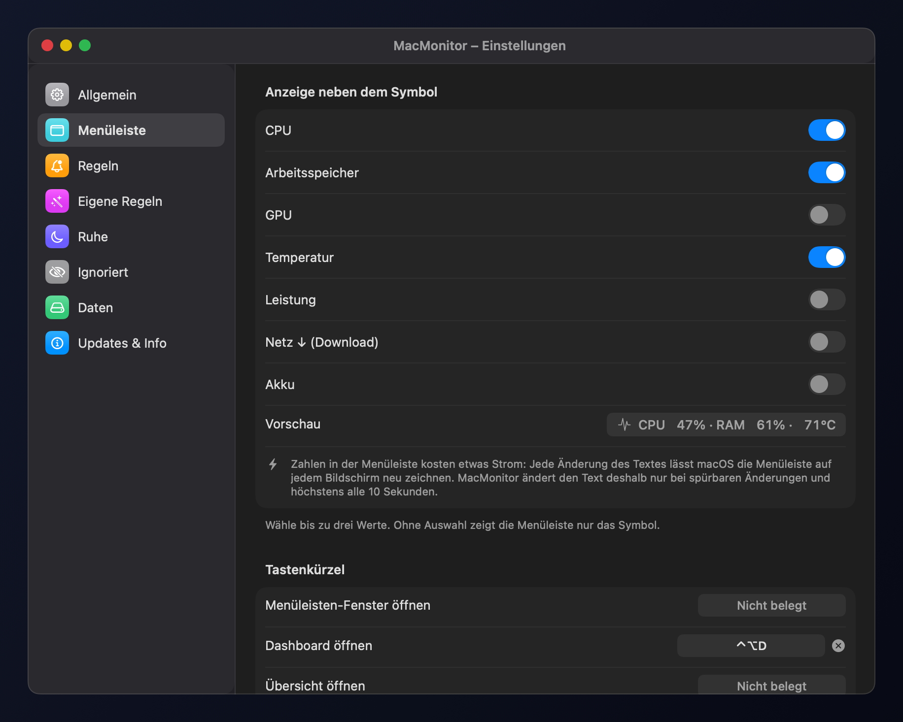
</p>
<p align="center">
  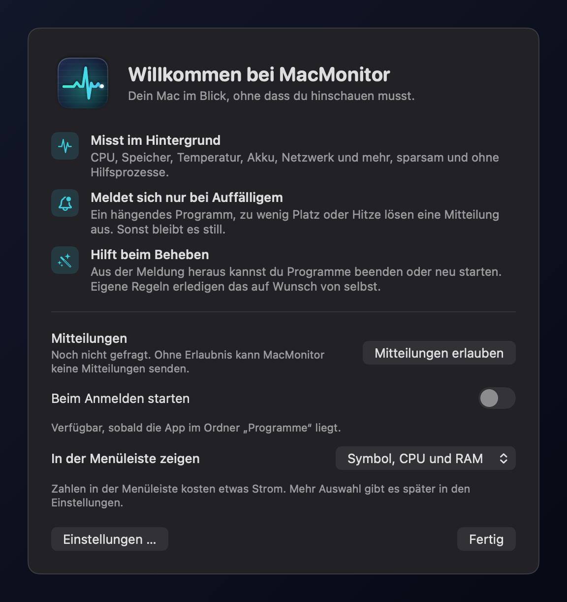
</p>

Einstellungen lassen sich unter **Daten** als JSON exportieren und wieder importieren.

### Hinweis auf dem Bildschirm, an dem du arbeitest

macOS zeigt Mitteilungs-Banner nur auf dem Hauptbildschirm. Wer an externen Monitoren arbeitet, sieht sie
nicht. MacMonitor blendet deshalb zusätzlich ein eigenes Hinweisfenster oben rechts auf dem Bildschirm
ein, auf dem gerade der Mauszeiger ist. Es nimmt keinen Fokus, verschwindet nach 12 s (kritisch 30 s)
und bietet dieselben Aktionen. Einstellbar: aus, nur an anderen Bildschirmen (Standard), immer.

<p align="center">
  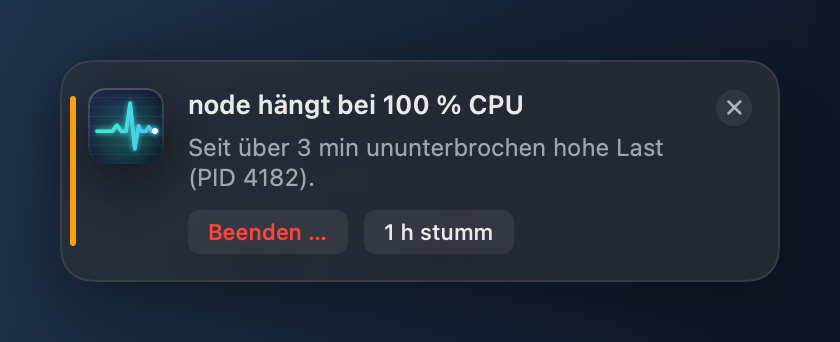
</p>

Testen: `open macmonitor://test` oder „Testmitteilung senden“ in den Einstellungen. Die Übersicht öffnet
`open macmonitor://overview`, direkt beim Aufräumen `open macmonitor://cleanup`.

**Damit es nicht nervt:**

- **Dauer statt Momentaufnahme.** Eine Regel meldet erst, wenn der Zustand ununterbrochen anhält. Kurze
  Spitzen beim Kompilieren oder Öffnen einer App lösen nichts aus.
- **Einmal melden, dann Ruhe.** Danach kommt erst wieder eine Mitteilung, wenn es schlimmer wird oder
  als Erinnerung nach 30 min (einstellbar).
- **Hysterese.** Zum Abklingen muss ein Wert deutlich unter die Schwelle fallen (85 %). Werte, die um
  die Grenze pendeln, flackern so nicht zwischen „Warnung“ und „OK“.
- **Schlaf zählt nicht.** Nach dem Aufwachen beginnen alle laufenden Zeitfenster neu.

## Warum sie so wenig Strom braucht

Das Vorgänger-Plugin für SwiftBar startete bei jeder Messung `top`, `ps`, `awk`, `sed` und `python3`.
MacMonitor startet **keinen einzigen Hilfsprozess**. Gemessen auf einem MacBook Pro (M4 Pro), Popover
geschlossen: **0,12 s CPU-Zeit in 162 s (≈ 0,07 % CPU)** bei konstant ~79 MB Speicher.

- **Direkte Systemaufrufe:** `host_statistics` (CPU), `host_statistics64` (VM), `sysctl`
  (Swap, Speicherdruck, 64-Bit-Netzwerkzähler), `proc_pid_rusage` (CPU-Zeit und Footprint je Prozess),
  IOKit (Akku, Ladezyklen, Power-Assertions).
- **Adaptives Intervall:** 2 s bei offenem Popover, 10 s am Netzteil, 20 s im Akkubetrieb, 30 s im
  Stromsparmodus.
- **Gebündelte Weckungen:** Ein `DispatchSourceTimer` mit 25 % Toleranz lässt macOS die Messungen mit
  anderer Arbeit zusammenlegen.
- **Ereignisse statt Abfragen:** Speicherdruck, Temperatur, Netzwechsel, Stromquelle und Aufwachen
  lösen sofort eine Messung aus, ohne dass dafür häufiger gemessen werden muss.
- **Ruhige Menüleiste:** Jede Textänderung in der Menüleiste lässt macOS das Symbol auf jedem Bildschirm
  neu rendern (~40 ms). Standard ist deshalb „Nur Symbol“, das nur bei Warnungen wechselt. Wer Zahlen
  sehen will, bekommt sie gedrosselt: neu gezeichnet wird erst, wenn sich der angezeigte Text spürbar
  ändert (5 Punkte bei Prozent, 2 °C, 1 W unter 20 W sonst 5 W, grobe Stufen beim Netz), höchstens alle 10 s.
- **Caches:** Prozessnamen werden je PID nur einmal aufgelöst, SSD-Platz und Akkuzustand nur alle
  5 min gelesen, Schlaf-Blockierer jede Minute.

## Installation

Voraussetzung: macOS 15 oder neuer.

1. Die aktuelle `MacMonitor-<Version>.dmg` von der [Releases-Seite](https://github.com/fbrogno/mac-monitor/releases/latest) laden.
2. DMG öffnen und MacMonitor in den Ordner „Programme“ ziehen.
3. Starten. macOS fragt beim ersten Start, ob MacMonitor Mitteilungen senden darf. Gleichzeitig trägt sich
   die App als Anmeldeobjekt ein (abschaltbar in den Einstellungen).

Die App ist mit Developer ID signiert und von Apple notarisiert. Neue Versionen lädt sie selbst über
[Sparkle](https://sparkle-project.org): automatisch im Hintergrund (abschaltbar) oder per
„Nach Updates suchen …“ in den Einstellungen. Ein gefundenes Update meldet sie ruhig per Mitteilung und
mit einem Knopf im Popover, ohne ungefragt ein Fenster zu öffnen.

## Bauen und Release

Voraussetzung: Xcode 26 und [XcodeGen](https://github.com/yonaskolb/XcodeGen) (`brew install xcodegen`).
Das Xcode-Projekt entsteht aus `project.yml` und wird nicht eingecheckt.

```bash
swift build                 # Debug-Build der Bibliothek und der UI (ohne Sparkle-Updater)
swift test                  # Tests für MonitorCore (Swift Testing)
./scripts/build-app.sh      # build/MacMonitor.app (Release, über Xcode)
./scripts/install.sh        # bauen, nach /Applications kopieren, starten
./scripts/release.sh        # signieren, DMG, notarisieren, Appcast (siehe docs/RELEASING.md)
./scripts/make-icon.sh      # Resources/AppIcon.icns aus AppIconView rendern
./scripts/render-docs.sh    # README-Bilder in docs/images neu rendern
```

`build-app.sh` signiert mit der Identität aus `SIGN_IDENTITY`. Ohne Angabe nimmt es „Developer ID
Application“, sonst „Apple Development“, sonst ad hoc (`SIGN_IDENTITY=-`). Die Version steht in der Datei
`VERSION`, die Build-Nummer ist die Anzahl der Commits. Ein Release entsteht, indem ein Tag `vX.Y.Z` gesetzt
wird, siehe [docs/RELEASING.md](docs/RELEASING.md).

## Entwicklung

Icon und Screenshots werden **aus Code gerendert** (`MacMonitor --render-docs <ordner>`): aus derselben
`AppIconView` und `PopoverView` wie in der App, mit festen Demodaten. Bilder und App können so nicht
auseinanderlaufen.

### Aufbau

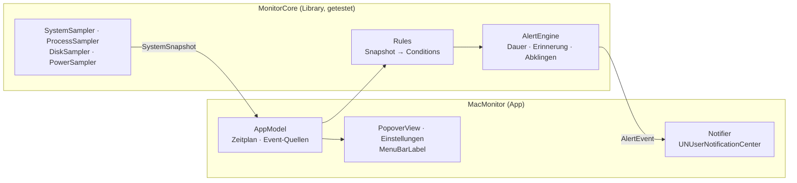

| Ordner | Inhalt |
|---|---|
| `Sources/MonitorCore/Metrics` | Messung über Mach, sysctl, libproc, IOKit |
| `Sources/MonitorCore/Alerts` | Regeln (reine Funktionen), AlertEngine, Einstellungen |
| `Sources/MacMonitor` | App, Zeitplan, Mitteilungen, SwiftUI-Oberfläche, Sparkle-Updater, Doc-Renderer |
| `project.yml`, `Config` | XcodeGen-Projekt der App, öffentlicher Sparkle-Schlüssel |
| `scripts`, `.github/workflows` | Bauen, Release, CI |
| `Tests/MonitorCoreTests` | Engine, Regeln, CPU-Deltas inkl. PID-Wiederverwendung |
| `docs/specs` | Design-Dokument |

## Grenzen

- Ohne Root-Rechte verweigert der Kernel `proc_pid_rusage` für Prozesse anderer Benutzer (z. B.
  root-Dienste). Diese erscheinen nicht in der Prozessliste. In Gesamt-CPU und Speicher sind sie
  trotzdem enthalten.
- Temperatur wird als thermischer Zustand von macOS gemeldet, nicht in Grad. Auf Apple Silicon gibt es
  keine öffentliche Schnittstelle für Sensorwerte.

## Lizenz

Privat. Alle Rechte vorbehalten.
