<a id="top"></a>

<p align="right"><b>English</b> · <a href="README.de.md">Deutsch</a></p>

<p align="center">
  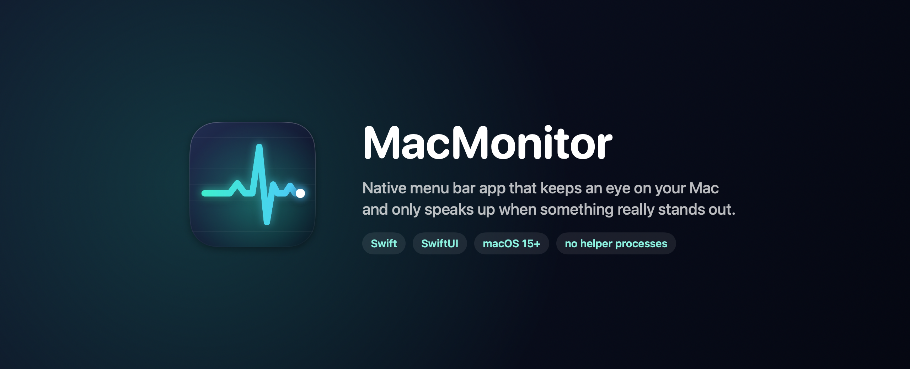
</p>

<p align="center">
  <b>MacMonitor</b> is a native macOS menu bar app that watches your Mac, tells you in plain words when something is wrong, and offers the button that fixes it.
</p>

<p align="center">
  <a href="https://github.com/fbrogno/mac-monitor/releases/latest"></a>
  <a href="https://github.com/fbrogno/mac-monitor/releases"></a>
  
  
  <a href="LICENSE"></a>
  <a href="https://github.com/fbrogno/mac-monitor/actions/workflows/ci.yml"></a>
  <a href="https://github.com/fbrogno/mac-monitor"></a>
</p>

<p align="center">
  <a href="https://github.com/fbrogno/mac-monitor/releases/latest"></a>
</p>

<p align="center">
  <a href="#features">Features</a> ·
  <a href="#install">Install</a> ·
  <a href="#shortcuts-and-automation">Shortcuts</a> ·
  <a href="#widgets">Widgets</a> ·
  <a href="#faq">FAQ</a>
</p>

<p align="center">
  <picture>
    <source media="(prefers-color-scheme: dark)" srcset="docs/images/en/popover-dark.png">
    <source media="(prefers-color-scheme: light)" srcset="docs/images/en/popover-light.png">
    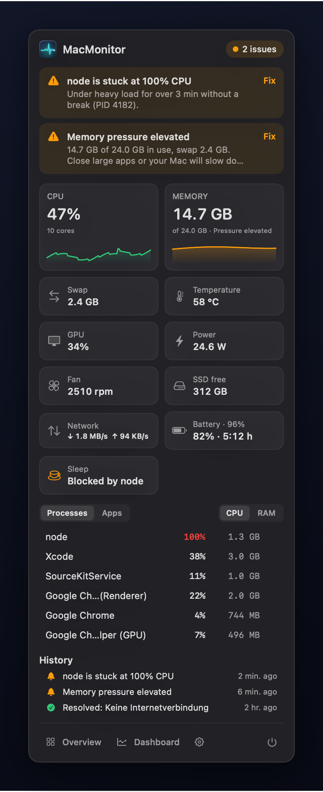
  </picture>
</p>

<details>
<summary><b>Contents</b></summary>

- [Why MacMonitor](#why-macmonitor)
- [Features](#features)
- [Reference](#reference): [rules](#all-17-built-in-rules) · [measurements](#everything-it-measures) · [dashboard](#the-dashboard-nine-areas) · [custom rules](#custom-rules-and-actions) · [settings](#settings-tab-by-tab)
- [How it works](#how-it-works)
- [Widgets](#widgets)
- [Shortcuts and automation](#shortcuts-and-automation)
- [Install](#install) · [Uninstall](#uninstall)
- [Energy use](#energy-use)
- [Privacy](#privacy)
- [Known limits](#known-limits)
- [FAQ](#faq)
- [Build from source](#build-from-source) · [Contributing](#contributing) · [Security](#security)
- [Star history](#star-history) · [License](#license)

</details>

## Why MacMonitor

Most monitors show numbers and leave the reading to you. MacMonitor stays quiet while your Mac is fine and measures with almost no load of its own. When something stays wrong for a while, a process that hangs, memory that runs out, a hot CPU, a disk that fills up, it sends a real macOS notification. It says what is going on in plain words, names the likely cause, and gives you the buttons to deal with it: restart the app, quit it, mute it, clean up the disk.

Short spikes do not count. A rule reports only after the condition has held without a break, and then it stays quiet until things get worse or a reminder is due.

<p align="right"><a href="#top">↑ back to top</a></p>

## Features

<table>
  <tr>
    <td width="33%" valign="top">
      <picture>
        <source media="(prefers-color-scheme: dark)" srcset="docs/images/en/popover-dark.png">
        <source media="(prefers-color-scheme: light)" srcset="docs/images/en/popover-light.png">
        
      </picture>
      <br><b>Popover</b><br>
      All live values on one page: CPU, memory, swap, GPU, temperature, power, fans, SSD, network, battery. Processes or apps, sorted by CPU or RAM, and the latest alerts.
    </td>
    <td width="33%" valign="top">
      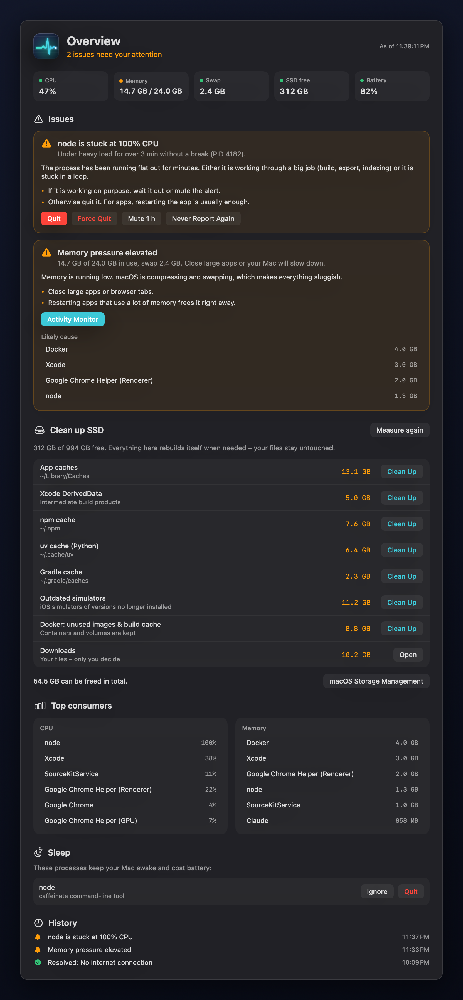
      <br><b>Overview with fixes</b><br>
      Every alert with an explanation, concrete steps and the buttons that do it. For memory or CPU problems it lists the likely culprits right away.
    </td>
    <td width="33%" valign="top">
      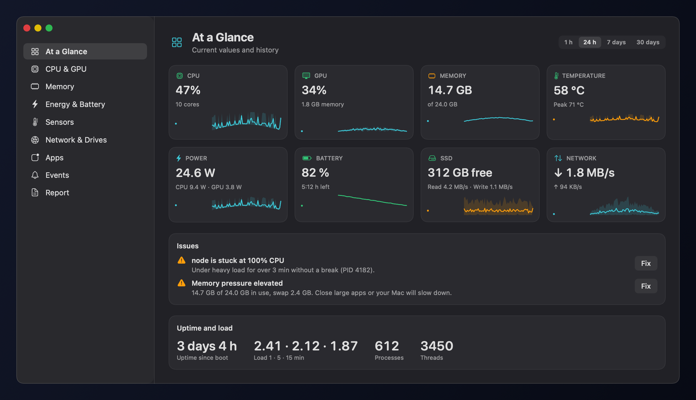
      <br><b>Dashboard with history</b><br>
      Nine areas, live values and charts from 1 hour to 30 days, a day or week report, CSV and JSON export.
    </td>
  </tr>
  <tr>
    <td width="33%" valign="top">
      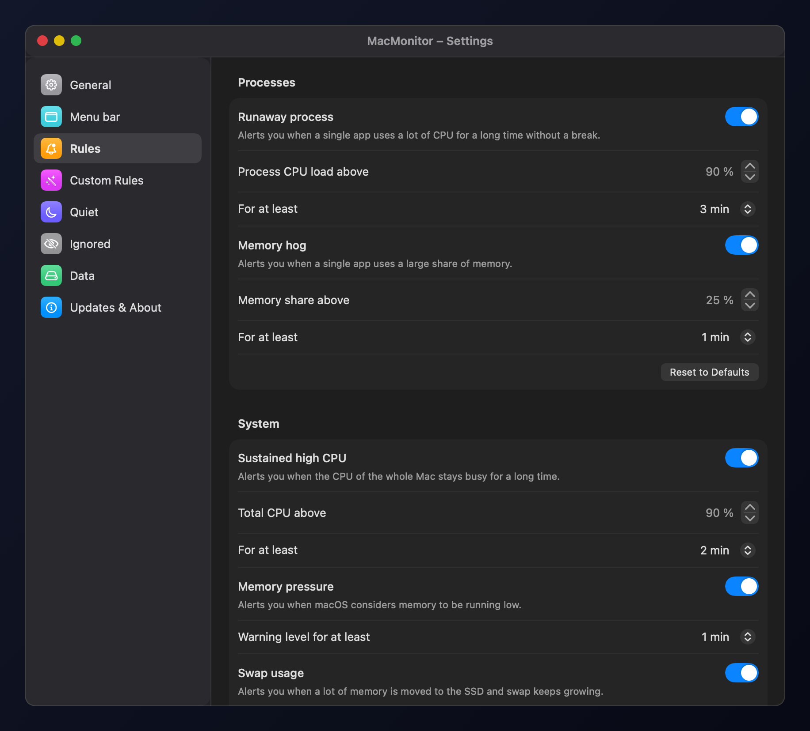
      <br><b>17 built-in rules</b><br>
      Thresholds and durations are yours to change, per group, with "Reset to default". Processes can be ignored for good or muted for an hour.
    </td>
    <td width="33%" valign="top">
      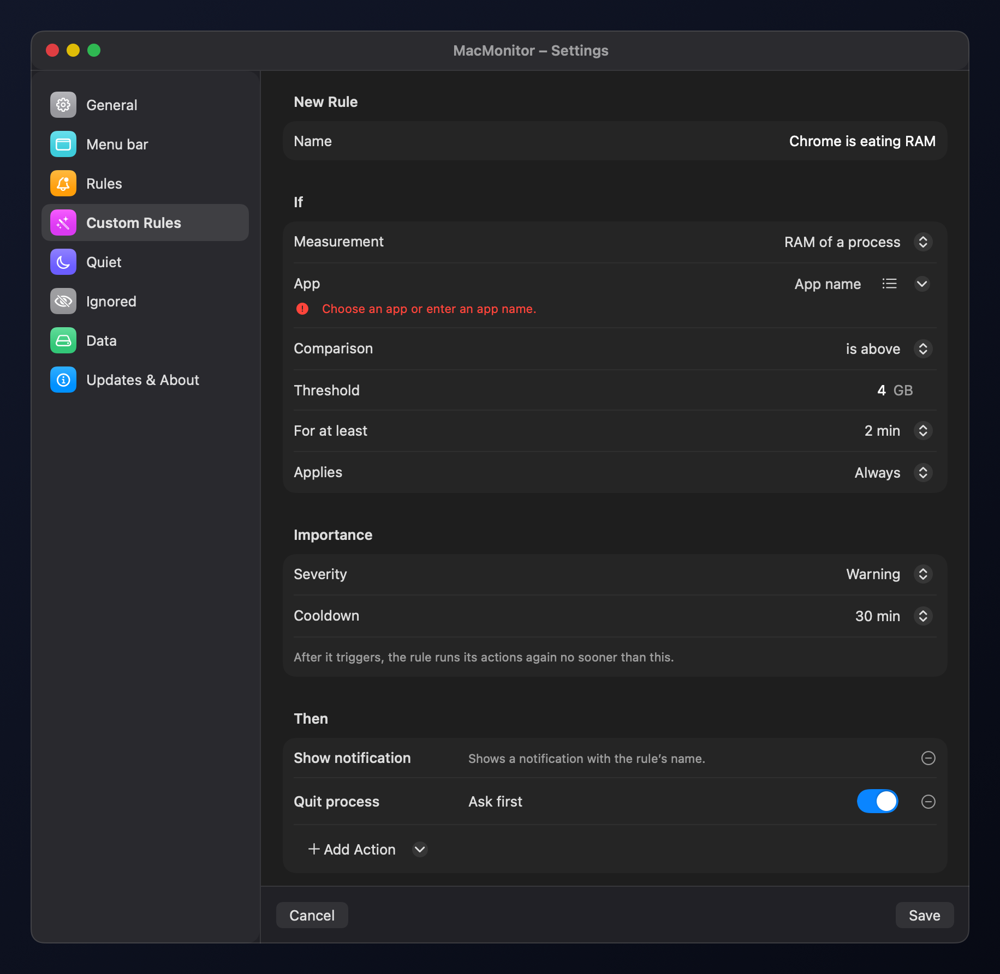
      <br><b>Custom rules with actions</b><br>
      Pick a measurement, a limit and a duration. Then show a notification, run a Shortcut, open a URL, quit or throttle a program.
    </td>
    <td width="33%" valign="top">
      <picture>
        <source media="(prefers-color-scheme: dark)" srcset="docs/images/en/widget-status-medium-alert.png">
        <source media="(prefers-color-scheme: light)" srcset="docs/images/en/widget-status-medium-light.png">
        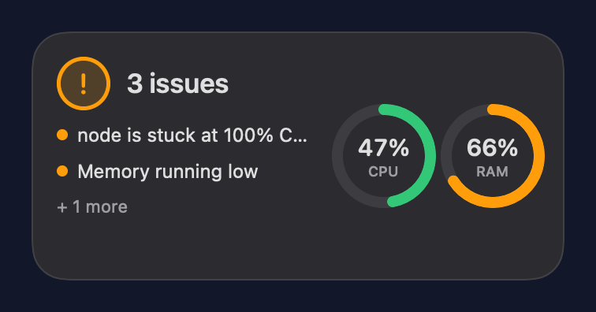
      </picture>
      <br><b>Five widgets</b><br>
      Status, load, battery, storage and top apps for the desktop and Notification Center.
    </td>
  </tr>
  <tr>
    <td width="33%" valign="top">
      
      <br><b>Shortcuts, Spotlight, Siri</b><br>
      Seven actions: read the status, the top consumers and the alerts, open the dashboard, mute and unmute.
    </td>
    <td width="33%" valign="top">
      
      <br><b>Clean up SSD</b><br>
      Measures caches that rebuild themselves and empties them after you confirm. Downloads are only opened, never deleted.
    </td>
    <td width="33%" valign="top">
      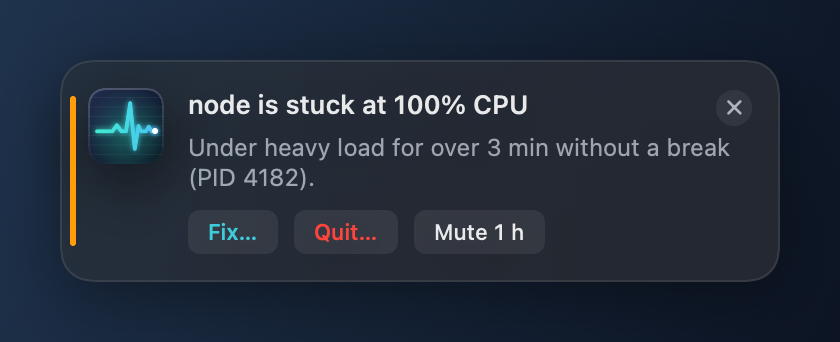
      <br><b>Alert panel on your screen</b><br>
      macOS shows banners only on the main display. MacMonitor adds a panel on the screen where your pointer is.
    </td>
  </tr>
</table>

<p align="right"><a href="#top">↑ back to top</a></p>

## Reference

The long parts are folded. Open what you need.

### All 17 built-in rules

<details>
<summary><b>Rules with their default values</b></summary>

&nbsp;

Every threshold and duration can be changed in **Settings, Rules**. The rules are grouped as shown. 16 are on by default; "High GPU load" is off.

| Group | Rule | Reports when (default) | Notes |
|---|---|---|---|
| Processes | Runaway process | one process uses 90 % CPU or more for 3 min | "100 %" is one fully busy core, as in Activity Monitor |
| Processes | Memory hog | one process holds 25 % of the RAM or more for 1 min | |
| System | High CPU load | whole-Mac CPU at 90 % or more for 2 min | lists the biggest consumers |
| System | Memory pressure | macOS reports "warning" for 1 min, "critical" at once | critical alerts break through quiet times |
| System | Swap use | swap at 8 GB or more, while it grows by 1 GB or more in 10 min or memory is tight | a high but shrinking swap is a leftover and stays quiet |
| System | Overheating | thermal state "serious" or "critical", at once | macOS is already throttling |
| System | High CPU temperature | hottest CPU sensor at 95 °C or more for 2 min | steps aside while the overheating rule is speaking |
| System | Fan at its limit | a fan at 90 % of its top speed or more for 5 min | only on Macs with fans |
| System | High GPU load | GPU at 90 % or more for 5 min | **off by default** |
| System | No internet | offline for 30 s | an entry "resolved" when the connection is back |
| Energy and battery | Battery health | capacity below 80 % of new, or macOS says "Service recommended" | at most once a week, severity "info" |
| Energy and battery | Draining while plugged in | on the adapter, not charging, battery losing 1 W or more for 10 min | adapter probably too weak |
| Energy and battery | Energy hog on battery | one app averages 8 W or more over 5 min on battery | per app, helpers included |
| Energy and battery | Sleep blocked | a process keeps the Mac awake for more than 30 min on battery | named with the program that started it |
| Storage | Disk full | less than 10 % or less than 15 GB free on the startup volume | "critical" below 5 GB |
| Storage | Volume full | another volume of 1 GB or more (for example an external drive) under the same limits | the startup volume belongs to "Disk full" |
| Storage | SSD wear | wear at 80 % or more, or spare below 20 % | at most once a week; "warning" at 90 % wear or spare below 10 %, otherwise "info" |

Three behaviors apply to all rules: a rule reports only after its duration, it comes back as a reminder every 30 min (15 min, 30 min, 1 h or never in **Settings, General**), and a value must fall clearly below the limit (to 85 %) before the alert counts as resolved. A value the Mac does not report never triggers anything.

</details>

### Everything it measures

<details>
<summary><b>All measurements, by group</b></summary>

&nbsp;

A measurement that your Mac does not report is hidden or marked "not available". It is never shown as 0.

| Group | What |
|---|---|
| CPU | total load; load per core, split into efficiency and performance cores on Apple Silicon; load average (1, 5, 15 min) |
| Processes | CPU, RAM footprint, threads and disk read/write per process; energy per process on Apple Silicon; helper processes grouped under their app |
| Memory | used and installed RAM, memory pressure level, swap |
| GPU | utilization, GPU memory in use and reserved |
| Temperature and fans | thermal state (nominal, fair, serious, critical); CPU die temperature (average and maximum); battery temperature; all sensors in a list; fan speed with minimum and maximum |
| Power | whole-system power, input from the adapter; CPU, GPU, Neural Engine and RAM power on Apple Silicon |
| Battery | charge, charging state, time remaining or to full; cycles; capacity in mAh against design capacity; condition; temperature; charge or discharge power; adapter rating |
| Storage | free and total space of the startup volume and of other volumes; read and write rate; SSD health from the drive's own diagnostics (wear, spare, temperature, power-on hours, data written) |
| Network | online or offline; download and upload rate in total and per interface; active interface (Wi-Fi, Ethernet, other) and local IP address |
| Sleep | programs that keep the Mac awake, with their reason and the program that started them |
| System | uptime, number of processes and threads |

What differs by Mac is covered in [Known limits](#known-limits).

</details>

### The dashboard: nine areas

<details>
<summary><b>Dashboard areas, with screenshots</b></summary>

&nbsp;

Open it from the popover, with a [keyboard shortcut](#settings-tab-by-tab) or with `open macmonitor://dashboard`. Each area has a range switch: 1 hour, 24 hours, 7 days, 30 days. Charts show the average with a band from minimum to maximum, and a tooltip on hover.

| Area | Shows |
|---|---|
| Overview | all key values as tiles with a small chart, current alerts with "Fix" buttons, uptime, load and process count |
| CPU & GPU | CPU over time with efficiency and performance cores, per-core bars, GPU load and GPU memory, system load |
| Memory | usage, pressure and swap over time |
| Energy & Battery | system power split into CPU, GPU, Neural Engine and RAM, charge level, battery condition |
| Sensors | temperatures, fans and SSD health |
| Network & Drives | throughput total and per interface, connection, drives, read and write rate |
| Apps | all apps now with CPU, RAM, energy, threads and disk activity, helpers expandable; the biggest consumers over the chosen range |
| Events | all alerts in the range, grouped into incidents with duration, and the raw log |
| Report | a day or week summary with change against the period before, incidents per rule, top programs, export and delete |

<table>
  <tr>
    <td width="50%"><br><sub>Overview</sub></td>
    <td width="50%">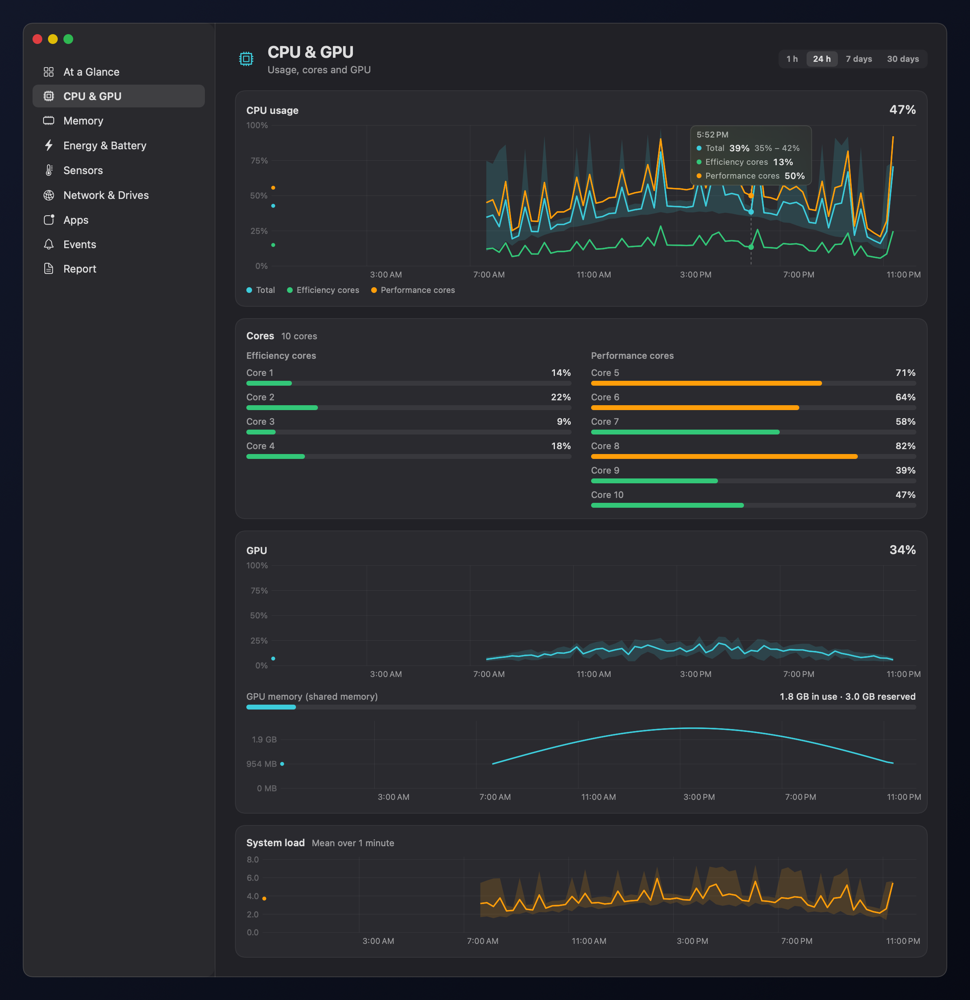<br><sub>CPU &amp; GPU</sub></td>
  </tr>
  <tr>
    <td width="50%">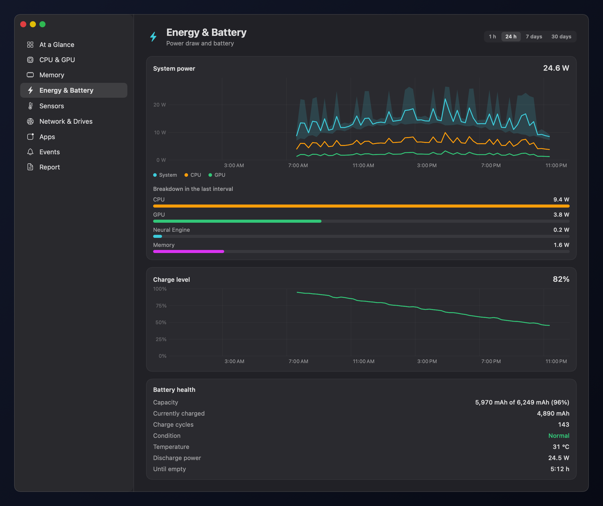<br><sub>Energy &amp; Battery</sub></td>
    <td width="50%"><br><sub>Apps</sub></td>
  </tr>
  <tr>
    <td colspan="2">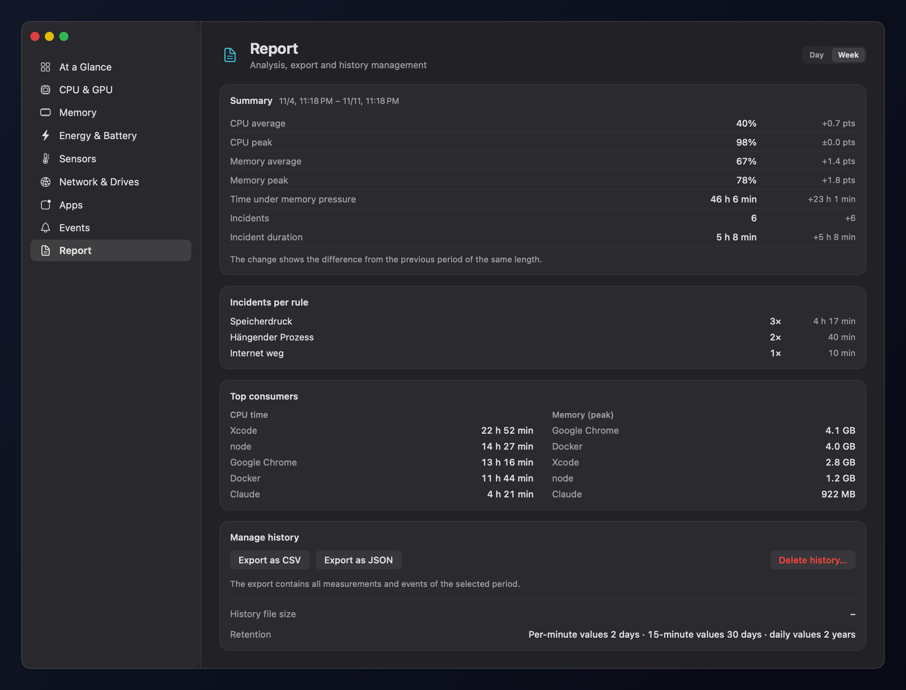<br><sub>Report</sub></td>
  </tr>
</table>

**History.** It lives in one SQLite file on your Mac. Minute values are kept for 2 days, 15-minute values for 30 days, daily values for 2 years. Alerts are kept for 90 days. The report exports a chosen period as CSV or JSON and can delete the whole history.

</details>

### Custom rules and actions

<details>
<summary><b>How custom rules work, and what protects you</b></summary>

&nbsp;

**Settings, Custom rules** lets you define what MacMonitor should watch.

- **Measurement** (13): total CPU, memory used, swap, GPU load, CPU temperature, fan speed, system power, battery level, free disk space, network download, network upload, CPU of one program, RAM of one program.
- **Condition:** above or below a threshold, for a minimum duration (default 1 min), only on battery or only on the adapter if you like.
- **Importance:** info, warning or critical, and a cool-down (default 30 min) before the actions can run again.
- **Actions:** show a notification, run a Shortcut from your list, open a URL, quit a program (optionally after asking you), throttle a program. Quit and throttle exist only for the two program measurements.

Five templates help you start, for example "Chrome eats RAM" (quit after asking, above 4 GB for 2 min) or "Battery below 20 %". Incomplete rules cannot be saved, and the editor says at the field what is missing. Every action that ran, and every failure, is in the event log. A rule that cannot be read is skipped when settings load; the others stay.


**Safety.**

- Actions run once when the rule fires, not again for reminders.
- "Quit" sends a polite termination request (SIGTERM), not a kill.
- System processes and MacMonitor itself are never touched. That covers low process IDs, a list of core macOS services, programs from `/System/Library`, and background daemons without an app bundle whose name ends in "d".
- Right before the signal, MacMonitor checks that the process ID still belongs to the same program. Process IDs are reused by macOS.
- Throttling lowers the priority (nice 10, background priority). It is not undone by itself. The event log says when the condition ends.
- "Open URL" accepts web addresses and addresses of apps. Local files and schemes such as `file`, `ssh` or `javascript` are refused.

</details>

### Settings, tab by tab

<details>
<summary><b>The eight settings tabs, quiet hours and keyboard shortcuts</b></summary>

&nbsp;

| Tab | Contents |
|---|---|
| General | start at login, alert panel (off, only when you are on another screen (default), always), reminder interval |
| Menu bar | up to three values next to the icon: CPU, RAM, GPU, temperature, power, network download, battery. Default: icon only. Three optional keyboard shortcuts |
| Rules | the 17 rules with switches, thresholds, durations, "Reset to default" per group |
| Custom rules | your own rules, templates, editor |
| Quiet | what is silenced and when |
| Ignored | programs that never trigger process alerts (default: `kernel_task`, `mds_stores`, `mdworker_shared`, `photoanalysisd`), and programs muted for now |
| Data | history size and retention, export, delete, export and import of your settings as JSON |
| Updates & Info | automatic update check, check now, version, privacy note |

<table>
  <tr>
    <td width="50%">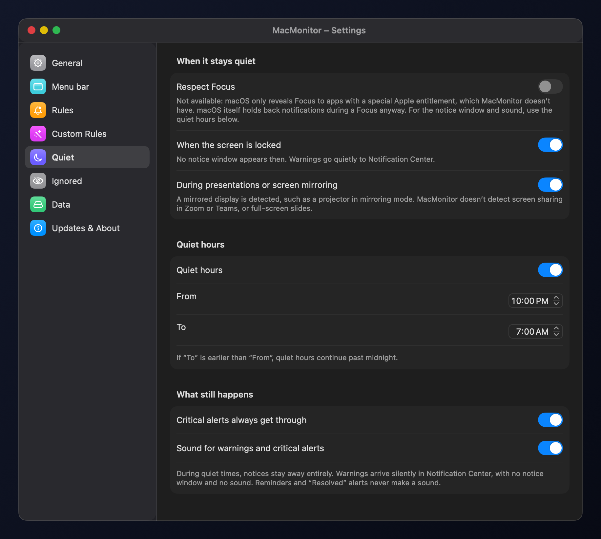</td>
    <td width="50%">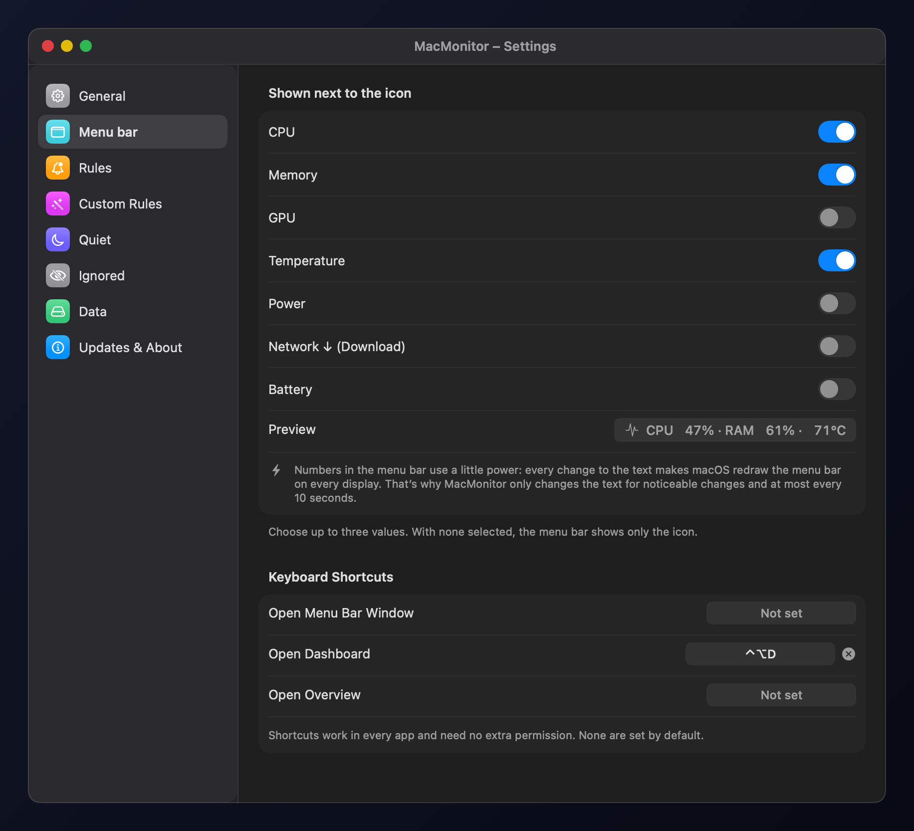</td>
  </tr>
</table>

**Quiet.** No alert panel and no sound while the screen is locked or a display is mirrored (a projector in mirror mode). Optional quiet hours (off by default, 22:00 to 07:00 when switched on, also across midnight). During quiet times info alerts are dropped. Warnings still arrive in Notification Center, without panel and sound. Critical alerts break through if you leave that switch on (default). Sound plays only for new and escalated warnings and critical alerts, never for reminders or "resolved". The "Respect Focus" switch is greyed out, see [Known limits](#known-limits).

**Keyboard shortcuts.** Open the popover, the dashboard, the overview. None is set by default. Pick one in Settings, Menu bar, for example <kbd>⌃</kbd> <kbd>⌥</kbd> <kbd>D</kbd> for the dashboard. They work in every app and need no Accessibility permission.

**Menu bar text** changes only when a value changes noticeably and at most every 10 seconds, because every change makes macOS redraw the menu bar on every display.

**First start.** A welcome window explains the app and asks for notifications. Open it again with `open macmonitor://welcome`.

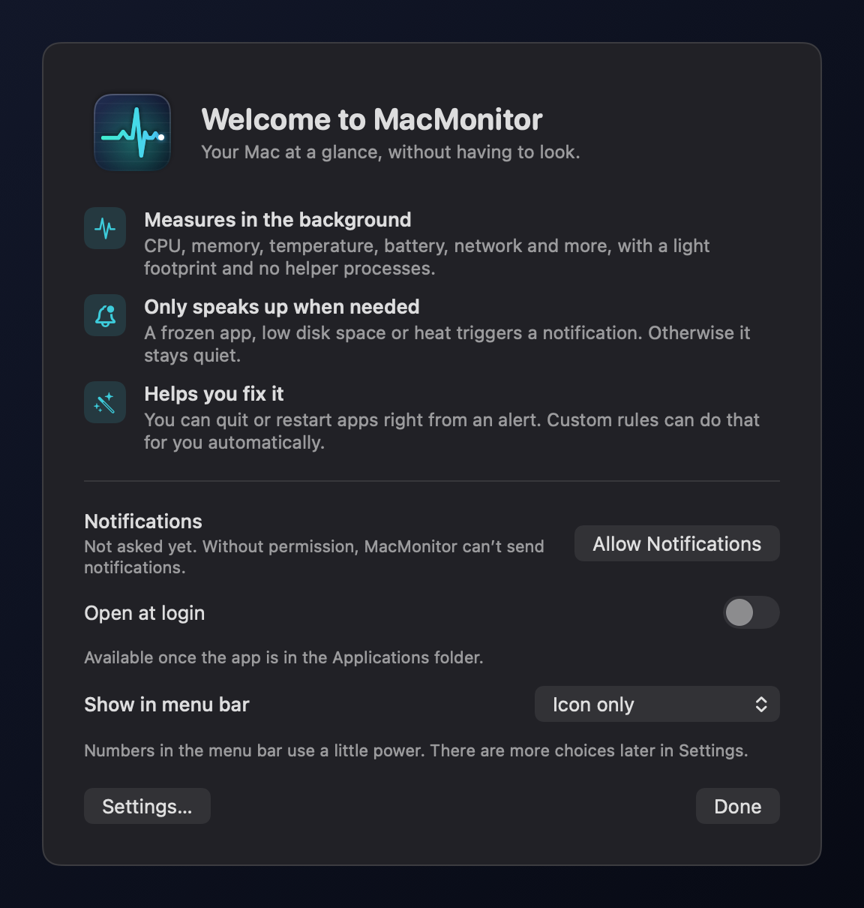

</details>

<p align="right"><a href="#top">↑ back to top</a></p>

## How it works

<details open>
<summary><b>Architecture</b></summary>

&nbsp;

Samplers read the Mac and produce one snapshot. Rules turn the snapshot into conditions. The alert engine decides what gets reported. History, widgets and Shortcuts read the same snapshot.

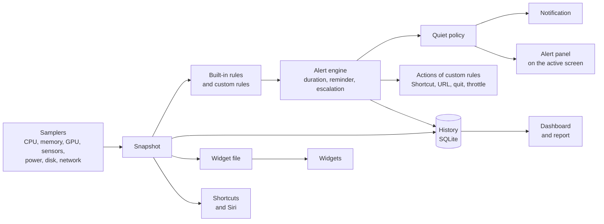

The rules are pure functions: a snapshot goes in, conditions come out, with no clock and no side effects. That is what makes them testable. The engine keeps the time.

</details>

<details open>
<summary><b>Life of an alert</b></summary>

&nbsp;

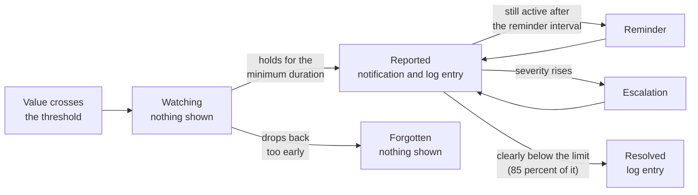

Time spent asleep does not count: after waking up, all alerts that are still being watched start their duration again. Alerts that were already reported stay.

</details>

<p align="right"><a href="#top">↑ back to top</a></p>

## Widgets

Five widgets for the desktop and Notification Center. They show data the app writes to a shared container, so they work while MacMonitor runs. If the data is older than 5 minutes, a widget says "MacMonitor is not running" and when it last saw the app.

| Widget | Sizes | Shows |
|---|---|---|
| Status | small, medium | traffic light, number of alerts, CPU and RAM |
| Load | medium | CPU, RAM and GPU with the last hour; extra values (temperature and power, only one of them, or none) are a setting of the widget |
| Battery and Energy | small, medium | charge, time remaining, power, battery health, cycles |
| Storage | small, medium | free space of the startup volume |
| Top apps | medium, large | the apps with the highest load |

A click on a widget opens the overview or the matching dashboard area.

<details>
<summary><b>Widget gallery</b></summary>

&nbsp;

<table>
  <tr>
    <td valign="top">
      <picture>
        <source media="(prefers-color-scheme: dark)" srcset="docs/images/en/widget-status-medium-alert.png">
        <source media="(prefers-color-scheme: light)" srcset="docs/images/en/widget-status-medium-light.png">
        
      </picture><br><sub>Status, medium</sub>
    </td>
    <td valign="top">
      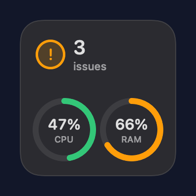<br><sub>Status, small</sub>
    </td>
  </tr>
  <tr>
    <td valign="top">
      <picture>
        <source media="(prefers-color-scheme: dark)" srcset="docs/images/en/widget-load-medium.png">
        <source media="(prefers-color-scheme: light)" srcset="docs/images/en/widget-load-medium-light.png">
        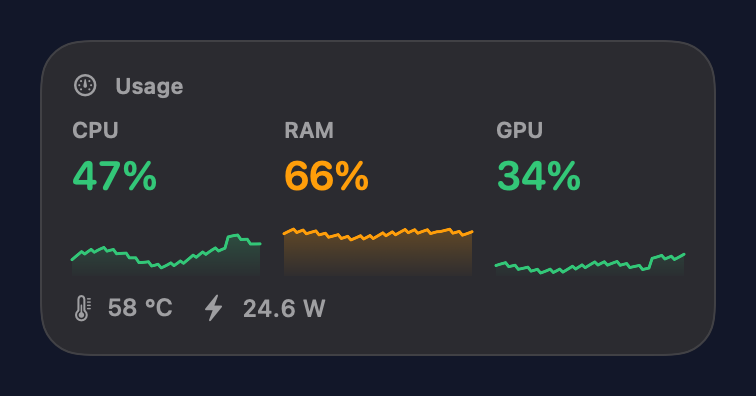
      </picture><br><sub>Load, medium</sub>
    </td>
    <td valign="top">
      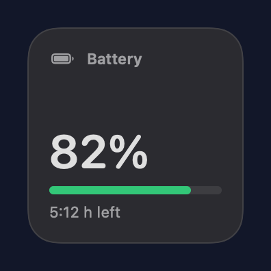<br><sub>Battery, small</sub>
    </td>
  </tr>
  <tr>
    <td valign="top">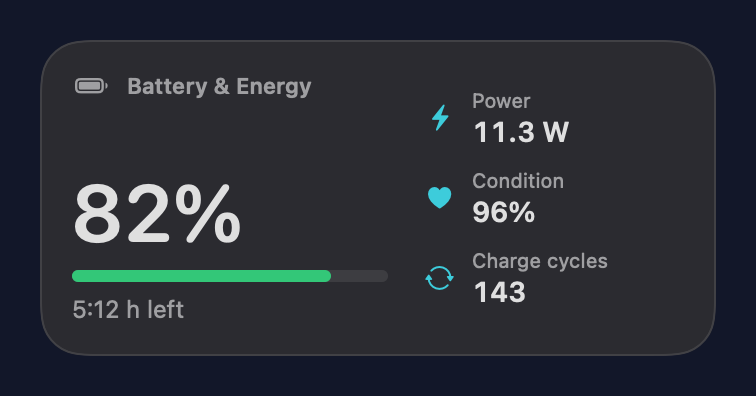<br><sub>Battery and Energy, medium</sub></td>
    <td valign="top">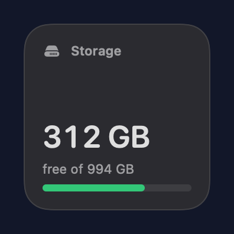<br><sub>Storage, small</sub></td>
  </tr>
  <tr>
    <td valign="top">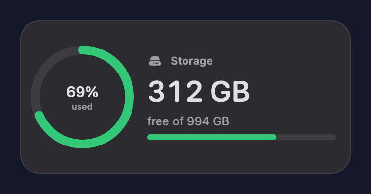<br><sub>Storage, medium</sub></td>
    <td valign="top">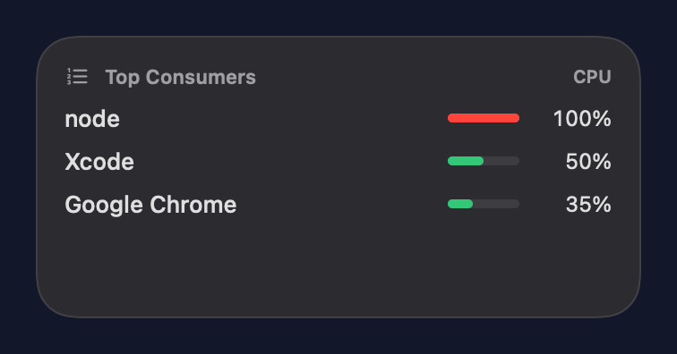<br><sub>Top apps, medium</sub></td>
  </tr>
  <tr>
    <td valign="top">
      <picture>
        <source media="(prefers-color-scheme: dark)" srcset="docs/images/en/widget-topapps-large.png">
        <source media="(prefers-color-scheme: light)" srcset="docs/images/en/widget-topapps-large-light.png">
        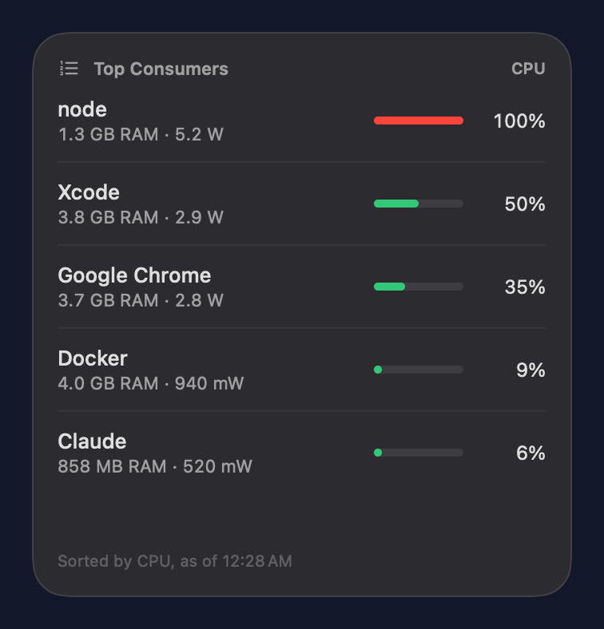
      </picture><br><sub>Top apps, large</sub>
    </td>
    <td valign="top">
      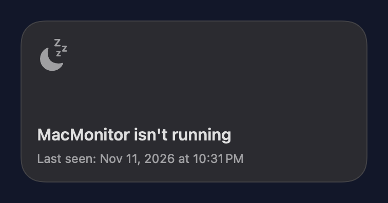<br><sub>When the app is not running (data older than 5 min)</sub><br><br>
      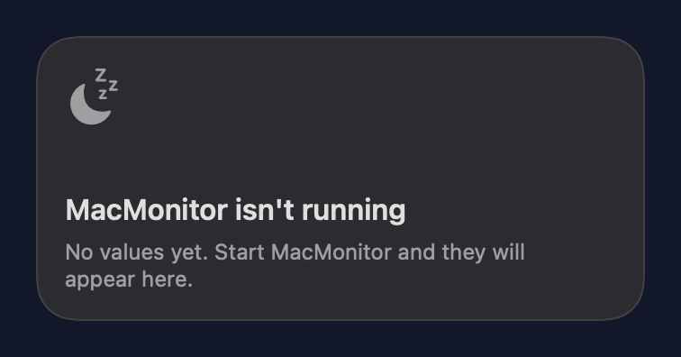<br><sub>Before the first measurement</sub>
    </td>
  </tr>
</table>

</details>

<p align="right"><a href="#top">↑ back to top</a></p>

## Shortcuts and automation

MacMonitor adds seven actions to the Shortcuts app. They also work from Spotlight and with Siri.

<details>
<summary><b>The seven actions, with example flows</b></summary>

&nbsp;

| Action | What it does |
|---|---|
| Get System Status | returns CPU, RAM, GPU, temperature, power, battery, free space, the number of alerts and a one-line summary |
| Get Top Consumers | returns the apps with the highest load, sorted by CPU, memory or energy (1 to 20, default 5) |
| Get Anomalies | returns the current alerts with title, severity and description |
| Open Dashboard | opens the dashboard in an area you choose |
| Open Overview | opens the overview with the current alerts |
| Mute Alerts | silences MacMonitor for a time you choose (default 1 hour) |
| Unmute Alerts | ends the mute |

These are ideas built from those actions. You assemble them yourself in the Shortcuts app:

- **Morning check.** Get System Status, then Show Result or Speak Text. You get the one-line summary.
- **Only when something is wrong.** Get Anomalies, then "If has any value", then send yourself a message with the titles.
- **Presentation.** At a time or when an app opens: Mute Alerts for 2 hours.
- **Heavy job finished.** Run it, then Unmute Alerts.
- **What slows my Mac?** Get Top Consumers, sorted by memory, then Show Result.

The other direction works too: a [custom rule](#custom-rules-and-actions) can run any Shortcut of yours when it fires.


</details>

<details>
<summary><b>URL commands</b></summary>

&nbsp;

For scripts, Shortcuts and the terminal. The app must be installed.

| Command | Opens |
|---|---|
| `open macmonitor://overview` | the overview |
| `open macmonitor://cleanup` | the overview at "Clean up SSD" |
| `open macmonitor://dashboard` | the dashboard (last area shown) |
| `open macmonitor://dashboard/<area>` | an area: `overview`, `cpu`, `memory`, `energy`, `sensors`, `network`, `apps`, `events`, `report` |
| `open macmonitor://settings` | the settings |
| `open macmonitor://settings/<tab>` | a tab: `general`, `menuBar`, `rules`, `customRules`, `quiet`, `ignored`, `data`, `about` |
| `open macmonitor://welcome` | the welcome window |
| `open macmonitor://about` | the about window |
| `open macmonitor://test` | sends a test notification |

German names such as `energie`, `netzwerk` or `eigene-regeln` are accepted as well.

</details>

<p align="right"><a href="#top">↑ back to top</a></p>

## Install

1. Download `MacMonitor-<version>.dmg` from the [latest release](https://github.com/fbrogno/mac-monitor/releases/latest).
2. Open the DMG and drag MacMonitor into **Applications**.
3. Start it. macOS asks whether MacMonitor may send notifications. Say yes: without it you only see the alert panel. On the first start from Applications the app also registers as a login item. You can switch that off in Settings, General.

The app is signed with a Developer ID and notarized by Apple. It updates itself through [Sparkle](https://sparkle-project.org), in the background (can be switched off) or with "Check for Updates" in Settings, Updates & Info. A found update is announced quietly with one notification and a button in the popover. No window opens unasked.

**Requirements:** macOS 15 or newer, Apple Silicon or Intel Mac. Some measurements depend on the model, see [Known limits](#known-limits).

### Uninstall

1. Switch off "Start at login" in Settings, General, and quit MacMonitor.
2. Move MacMonitor from Applications to the Trash.
3. Optionally remove what the app created:

| What | Where |
|---|---|
| Settings and custom rules | `~/Library/Preferences/com.fbrogno.macmonitor.plist` (or in Terminal: `defaults delete com.fbrogno.macmonitor`) |
| History | `~/Library/Application Support/MacMonitor/` |
| Widget data | `~/Library/Group Containers/<TeamID>.com.fbrogno.macmonitor` |

<p align="right"><a href="#top">↑ back to top</a></p>

## Energy use

MacMonitor does not start helper processes to measure (no `top`, `ps` or scripts). It calls the system directly: `host_statistics` for CPU, `host_statistics64` and `sysctl` for memory, swap, pressure and network counters, `proc_pid_rusage` for CPU time and footprint per process, IOKit for battery and power assertions.

- **Adaptive interval:** every 2 s while the popover is open, otherwise every 10 s on the adapter, 20 s on battery and 30 s in Low Power Mode. The timer has 25 % leeway so macOS can bundle the wake-ups with other work.
- **Events instead of polling:** memory pressure, thermal state, power source and wake from sleep trigger a measurement at once.
- **Caches:** SSD space, volumes, SSD health and battery health are read every 5 minutes, sleep blockers every minute. Sensors and power are read every 5 to 10 s while details are visible, every 30 to 60 s otherwise.
- **Quiet menu bar:** the default is the icon only, because every text change makes macOS redraw the menu bar (about 40 ms per display).

**Measurement from version 1.0** (MacBook Pro with M4 Pro, popover closed): 0.12 s of CPU time in 162 s, about 0.07 % CPU, at a constant ~79 MB of memory. Version 1.1 reads more (sensors, GPU, power, SSD, history, widgets) and has not been measured the same way yet. Treat the number as the 1.0 baseline, not as a promise for 1.1.

## Privacy

- Everything stays on your Mac: settings, history and widget data are local files.
- The only network connection is the update check at GitHub (`releases/latest/download/appcast.xml`). You can switch it off.
- No account, no analytics, no tracking. Details and file locations are in [PRIVACY.md](PRIVACY.md).

## Known limits

- **No network use per process.** MacMonitor shows throughput for the Mac and per interface. macOS offers no public way to attribute it to programs.
- **Focus mode is not detected.** macOS tells only apps with a special Apple entitlement whether Focus is on. The switch exists but is greyed out. macOS itself holds back notifications during Focus. For the alert panel and sound, use quiet hours.
- **Presentation detection works only with a mirrored display.** Screen sharing in Zoom or Teams and slides in full screen are not detected.
- **Processes of root or other users are not visible without root.** The kernel refuses their per-process figures. They are included in total CPU and memory, but missing from process lists.
- **Sensors depend on the Mac model.** Fans, temperatures, power split and SSD data are not reported by every model. On a Mac without fans or battery the tiles are not there. Per-process energy and the split of power into CPU, GPU, Neural Engine and RAM are Apple Silicon only, and the efficiency/performance split needs Apple Silicon too. Temperature and power use interfaces that Apple does not document and may change.
- **Not in the Mac App Store.** The sandbox would forbid core functions, see the [FAQ](#faq).

<p align="right"><a href="#top">↑ back to top</a></p>

## FAQ

<details>
<summary><b>Why is MacMonitor not in the Mac App Store?</b></summary>

&nbsp;

Apps in the Mac App Store must run in the sandbox. In the sandbox MacMonitor could not read the process list of your user, quit or throttle other programs, restart Wi-Fi, empty cache folders in your home directory, or read sensors and power through the system interfaces it uses. These are the core of the app. So it is distributed as a signed and notarized DMG from GitHub releases, and updates through Sparkle. Only the widget extension runs sandboxed, as WidgetKit requires.

</details>

<details>
<summary><b>Why are there no numbers in the menu bar by default?</b></summary>

&nbsp;

Every change of the text makes macOS redraw the menu bar item on every display, about 40 ms each. A number that changes every few seconds would use more energy than all of MacMonitor's measuring. The default is the icon only, which changes only when there is an alert. If you want numbers, choose up to three in Settings, Menu bar. They are redrawn only when they change noticeably and at most every 10 seconds.

</details>

<details>
<summary><b>Why do I not see process X?</b></summary>

&nbsp;

Three common reasons. The process belongs to root or another user: without root rights macOS refuses its figures, so it is missing from the lists, though its load is part of the totals. The process is on your ignore list (Settings, Ignored; `kernel_task` and a few indexing helpers are there by default). Or you look at the "Processes" view, where helpers appear as separate lines. Switch to "Apps" to see them added up under their app.

</details>

<details>
<summary><b>What exactly does "Clean up SSD" delete, and what never?</b></summary>

&nbsp;

It measures first and deletes nothing until you confirm each item. It only touches places that tools rebuild on demand:

- **App caches:** the contents of `~/Library/Caches`, except `ms-playwright`, because Playwright does not download its browsers again by itself. Open apps should be restarted afterwards.
- **Xcode DerivedData** (`~/Library/Developer/Xcode/DerivedData`): the next build takes longer once.
- **npm cache:** `~/.npm/_cacache`.
- **uv cache:** `~/.cache/uv`. Other folders in `~/.cache` are left alone on purpose, because some hold indexes and data that are no throw-away caches.
- **Gradle cache:** `~/.gradle/caches`.
- **Outdated simulators:** runs `xcrun simctl delete unavailable`, which removes only simulators whose iOS version is no longer installed. Shown only if Xcode tools are present.
- **Docker:** runs `docker image prune -a -f` and `docker builder prune -f`: unused images and the build cache. Containers, stopped or running, and volumes stay. Shown only if Docker is installed.

**Downloads** is only opened in Finder, never deleted, and nothing else in your home folder is touched. Items that are in use or protected are skipped. Deleted caches do not go to the Trash.

</details>

<details>
<summary><b>Does it run on Intel Macs?</b></summary>

&nbsp;

Yes, Intel Macs are supported (macOS 15 or newer is required). Some measurements are Apple Silicon only: energy per process, the split of power into CPU, GPU, Neural Engine and RAM, and the efficiency/performance core split (on Intel all cores count as one class). The CPU temperature comes from the classic sensors on Intel Macs. What a Mac does not report is hidden, not shown as 0.

</details>

<details>
<summary><b>How do I report a false alarm?</b></summary>

&nbsp;

Open the [False alarm template](https://github.com/fbrogno/mac-monitor/issues/new?template=false_alarm.yml). Say which rule it was, what MacMonitor said, what your Mac was doing, and your Mac model and macOS version. The log under Dashboard, Events has the exact text and time. Meanwhile you can raise the threshold or duration of that rule in Settings, Rules, mute the program for an hour from the notification, or put it on the ignore list.

</details>

<details>
<summary><b>Is it safe to let a custom rule quit programs?</b></summary>

&nbsp;

It is built to be careful, see "Safety" under [custom rules](#custom-rules-and-actions): system processes and MacMonitor itself are protected, the process ID is checked again right before the signal, and quitting can ask you first. Still, a rule that quits a program can lose unsaved work in it. Start with "ask first".

</details>

<p align="right"><a href="#top">↑ back to top</a></p>

## Build from source

You need macOS 15 or newer, Xcode 26 and [XcodeGen](https://github.com/yonaskolb/XcodeGen) (`brew install xcodegen`). The Xcode project is generated from `project.yml` and is not checked in.

```bash
swift build                              # library and UI, without the Sparkle updater
swift test                               # tests for MonitorCore
SIGN_IDENTITY=- ./scripts/build-app.sh   # build/MacMonitor.app, ad-hoc signed
```

Releases are built by GitHub Actions when a tag `vX.Y.Z` is pushed. How that works, and what it needs, is in [docs/RELEASING.md](docs/RELEASING.md) (German).

## Contributing

Bug reports, false alarms and small pull requests are welcome. [CONTRIBUTING.md](CONTRIBUTING.md) explains the layout of the repository, the tests, the style and the commit format (Conventional Commits). Please start with an issue for anything bigger.

## Security

Please report vulnerabilities privately through [GitHub Security Advisories](https://github.com/fbrogno/mac-monitor/security/advisories/new), not as public issues. See [SECURITY.md](SECURITY.md).

<p align="right"><a href="#top">↑ back to top</a></p>

## Star history

<a href="https://www.star-history.com/?repos=fbrogno%2Fmac-monitor&type=date&legend=top-left">
  <picture>
    <source media="(prefers-color-scheme: dark)" srcset="https://api.star-history.com/chart?repos=fbrogno/mac-monitor&type=date&theme=dark&legend=top-left">
    <source media="(prefers-color-scheme: light)" srcset="https://api.star-history.com/chart?repos=fbrogno/mac-monitor&type=date&legend=top-left">
    
  </picture>
</a>

<a href="https://github.com/fbrogno/mac-monitor/graphs/contributors">
  
</a>

## License

[MIT](LICENSE), Copyright (c) 2026 Fabio Brogno.

<p align="right"><a href="#top">↑ back to top</a></p>
